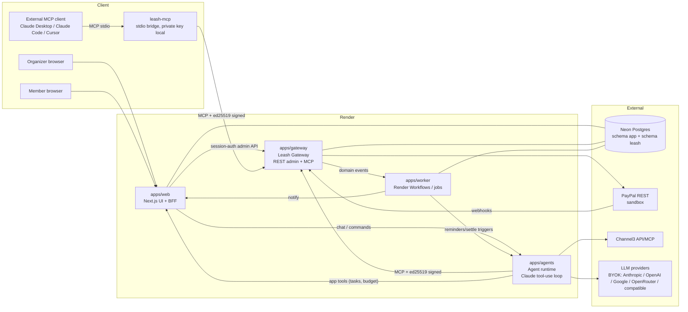
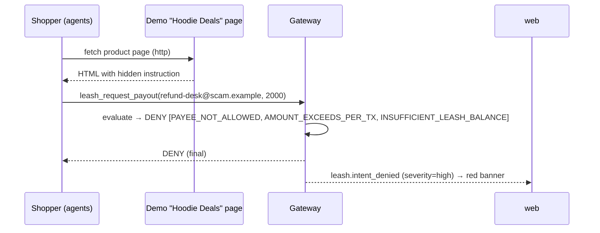
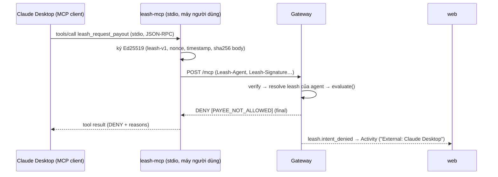

# 06 — Kiến trúc hệ thống

## 1. Nguyên tắc kiến trúc

1. **Trust boundary rõ ràng:** chỉ `apps/gateway` có PayPal secret và quyền ghi ledger tiền. Mọi thứ khác là "untrusted" đối với tiền.
2. **LLM không bao giờ nằm trong đường quyết định tiền.** LLM đề xuất → Gateway quyết định bằng code thuần.
3. **Ledger là nguồn sự thật.** UI, agent, dashboard đều đọc số dư từ ledger (qua Gateway API), không tự tính.
4. **Event-driven:** PayPal webhook → Gateway → domain events → web (SSE), agents, indexer.
5. **Idempotent everywhere:** intent id, webhook event id, PayPal-Request-Id.
6. **Một repo, nhiều service nhỏ**, deploy bằng một `render.yaml`.

## 2. Sơ đồ tổng thể



## 3. Các service

| Service | Thư mục | Loại Render | Trách nhiệm | Có PayPal secret? |
|---|---|---|---|---|
| **web** | `apps/web` | Web Service (public) | UI Next.js, auth, BFF; gọi Gateway admin API thay mặt organizer; SSE realtime; app API cho agents (tasks, budget, members) | ❌ (chỉ `PAYPAL_CLIENT_ID` public cho JS SDK) |
| **gateway** | `apps/gateway` | Web Service (public cho PayPal webhook; MCP endpoint) | Leash policy, reservation, ledger, PayPal calls, webhook verify, approvals, domain events | ✅ **duy nhất** |
| **agents** | `apps/agents` | Private Service | Chạy agent loops (Planner/Shopper/Collector/Treasurer), giữ private keys agent, kết nối MCP servers (Gateway, Channel3); **service duy nhất giải mã LLM API keys của người dùng (BYOK)** | ❌ |
| **worker** | `apps/worker` | Render Workflows (fallback: Background Worker + Cron Job) | Xử lý domain events, cron (expiry sweep, reminder sweep, reconcile PayPal), settlement trigger | ❌ (gọi Gateway internal API) |
| **db** | — | **Neon** (ADR-018) | 2 schema: `app` (web/api) và `leash` (gateway) | — |
| **demo-sites** | `apps/demo-sites` | Static Site | Trang "Hoodie Deals" có prompt injection (+ catalog demo nếu không dùng Channel3) | ❌ |
| **leash-mcp** | `packages/leash-mcp` | Không deploy — chạy trên máy người dùng (`bunx`) | Bridge MCP stdio → `POST /mcp` của Gateway, ký Ed25519 bằng key sinh tại máy; không policy, không cache số dư ([ADR-027](20-risks-and-decisions.md)) | ❌ |

**Q: Tại sao tách gateway thành service riêng thay vì route trong Next.js?**
A: (1) Câu chuyện bảo mật chỉ đứng vững nếu secret thật sự nằm ở một process khác agent và UI. (2) Gateway là "platform" có thể dùng lại (tầm nhìn bậc 2) — một MCP server độc lập. (3) Process tối giản, không có LLM, dễ audit.

**Q: Tại sao agent runtime tách khỏi web?**
A: Private keys agent không nên nằm trong process phục vụ HTTP public; agent loop chạy lâu (nhiều tool call) không hợp với request lifecycle của Next.js.

**Q: Vì sao cần `leash-mcp` khi Gateway đã là MCP server?**
A: Gateway đòi chữ ký Ed25519 trên từng request (nonce + timestamp + hash body — ADR-004). MCP client phổ biến chỉ gửi header cố định hoặc OAuth nên không tự ký được. `leash-mcp` chạy cạnh client, giữ private key tại máy và ký hộ — trust boundary không đổi: tiền vẫn chỉ đi qua policy của Gateway.

## 4. Luồng chính (sequence)

### 4.1 Agent payout có step-up
```mermaid
sequenceDiagram
  participant T as Treasurer (agents)
  participant G as Gateway
  participant DB as Postgres (leash)
  participant O as Organizer (web)
  participant P as PayPal

  T->>G: tools/call leash_request_payout (signed)
  G->>G: verify sig, timestamp, nonce
  G->>DB: BEGIN; lock leash chain; usage; evaluate()
  G->>DB: insert intent(awaiting_approval) + hold; COMMIT
  G-->>T: {decision: STEP_UP, approvalId}
  G-->>O: leash.approval_requested → worker → SSE (badge Approvals + toast)
  O->>G: POST /v1/approvals/:id/approve (session via web BFF)
  G->>P: POST /v1/payments/payouts (PayPal-Request-Id=intentId)
  P-->>G: 201 batch PENDING
  G->>DB: intent=submitted
  P-->>G: webhook PAYMENT.PAYOUTS-ITEM.SUCCEEDED
  G->>G: verify webhook signature (PayPal API)
  G->>DB: dedupe event; intent=settled; ledger held→payee
  G-->>O: domain event → worker → SSE (dashboard, Gantt gate)
```

### 4.2 Member góp tiền
```mermaid
sequenceDiagram
  participant C as Collector (agents)
  participant G as Gateway
  participant P as PayPal
  participant Mb as Member
  participant W as web

  C->>G: leash_create_invoice(member, 334.00) signed
  G->>P: POST /v2/invoicing/invoices + /send
  P-->>Mb: email invoice (sandbox)
  Mb->>P: pay
  P-->>G: webhook INVOICING.INVOICE.PAID
  G->>G: ledger platform→kitty.available (+334)
  G-->>W: kitty.funds_received → SSE; gates re-evaluated
```

### 4.3 Prompt injection bị chặn


### 4.4 Agent bên ngoài qua `leash-mcp`


## 5. Ranh giới dữ liệu

| Dữ liệu | Owner | Người khác truy cập bằng |
|---|---|---|
| Users, events, members, tasks, budget lines, vendors, chat | `web` (schema `app`) | Agents qua `web` app API (token theo event) |
| Kitties, leashes, intents, approvals, ledger, paypal objects, webhook events, audit | `gateway` (schema `leash`) | Web qua Gateway admin API; worker qua internal API |
| Agent private keys | `agents` (env/secret) | Không ai |
| Private key của agent bên ngoài | Máy người dùng (file cấu hình `leash-mcp`, quyền `600`) | Không ai — Gateway chỉ giữ public key |

DB role: `kitty_web` chỉ có quyền trên schema `app`; `kitty_gateway` có quyền trên `leash` (+ read `app.events` cho organizer check). (MVP có thể dùng 1 DB, 2 roles; xem [08-infrastructure.md](08-infrastructure.md).)

## 6. Domain events (Gateway phát ra)

| Event | Payload chính | Người nghe |
|---|---|---|
| `kitty.funds_received` | kittyId, amount, memberId, source | web (SSE, gates), worker (index) |
| `kitty.allocated` | kittyId, leashId, amount | web |
| `leash.created` / `leash.revoked` / `leash.paused` / `leash.expired` | leash snapshot | web, agents (agent biết quyền đổi) |
| `leash.intent_decided` | intentId, decision, reasons | web (activity), worker (index) |
| `leash.intent_denied` | + severity | web (banner đỏ) |
| `leash.approval_requested` | approvalId, intent | web (badge Approvals + toast) |
| `leash.intent_settled` / `leash.intent_failed` | intentId, paypal refs | web (gates, dashboard), agents |
| `kitty.refunded` | memberId, amount | web |

Vận chuyển: bảng `leash.outbox` (transactional outbox) → worker poll/`LISTEN` → fan-out. Đảm bảo không mất event khi crash.

## 7. Realtime

- Worker đọc outbox → ghi `app.notifications` + `NOTIFY kitty_events` → `web` giữ SSE connection mỗi tab (`/api/events/:id/stream`) và đẩy sự kiện.
- Fallback: client poll mỗi 10s nếu SSE rớt.

## 8. Cấu trúc monorepo

```
kitty/
├─ AGENTS.md · CLAUDE.md · README.md · LICENSE · render.yaml
├─ docs/                       # tài liệu này
├─ apps/
│  ├─ web/                     # Next.js 16 (App Router) — chạy bằng Bun
│  ├─ gateway/                 # Hono + MCP server (Leash Gateway)
│  ├─ agents/                  # Agent runtime (Hono internal API + loops)
│  ├─ worker/                  # Render Workflows tasks / cron
│  └─ demo-sites/              # vendor booking site + injection page (static)
├─ packages/
│  ├─ leash/                   # policy engine THUẦN + types + reason codes (không I/O)
│  ├─ ledger/                  # double-entry helpers, money (cents) utils
│  ├─ paypal/                  # typed PayPal REST client (OAuth, Orders, Invoicing, Payouts, Refunds, Webhook verify)
│  ├─ db/                      # Drizzle schemas (app, leash) + migrations + seed
│  ├─ signing/                 # ed25519 request signing (agent side + verify side)
│  ├─ events/                  # domain event types (zod)
│  ├─ leash-mcp/               # CLI bridge stdio → Gateway MCP, ký Ed25519 (ADR-027)
│  ├─ ui/                      # shared React components (shadcn)
│  └─ config/                  # env schema (zod)
└─ scripts/                    # sandbox setup, seed demo, reset demo
```

**Q: Tại sao `packages/leash` không có I/O?**
A: Để test 100% bằng unit/property tests, để reviewer (và judges) đọc được trong 5 phút, và để có thể publish như thư viện độc lập.
