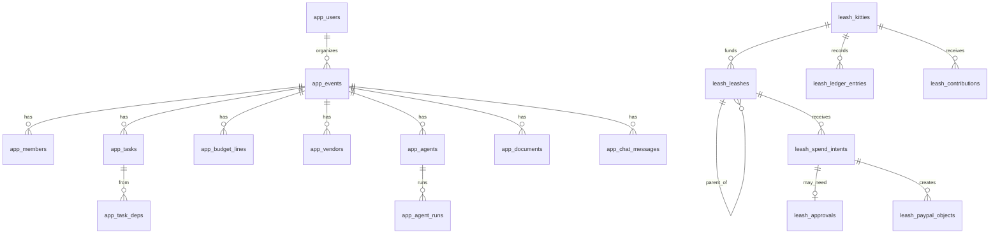

# 09 — Data Model

> Postgres 16, Drizzle ORM. Hai schema: `app` (owner: web) và `leash` (owner: gateway). Tiền luôn là `bigint` **cents**. Thời gian `timestamptz` UTC. ID là text ULID có prefix.

## 1. ERD tổng quan



## 2. Schema `app`

```sql
-- users / sessions: do Better Auth quản lý (bảng user, session, account, verification)

CREATE TABLE app.events (
  id            text PRIMARY KEY,              -- evt_…
  organizer_id  text NOT NULL REFERENCES app.user(id),
  title         text NOT NULL,
  description   text,
  location      text,
  timezone      text NOT NULL DEFAULT 'Asia/Ho_Chi_Minh',
  starts_on     date NOT NULL,
  ends_on       date NOT NULL,
  currency      text NOT NULL DEFAULT 'USD',
  budget_cents  bigint NOT NULL,
  per_member_cents bigint,                     -- mức góp đề xuất
  status        text NOT NULL DEFAULT 'planning', -- planning|collecting|active|settling|settled
  kitty_id      text UNIQUE,                   -- trỏ sang leash.kitties.id
  created_at    timestamptz NOT NULL DEFAULT now()
);

CREATE TABLE app.members (
  id            text PRIMARY KEY,              -- mem_…
  event_id      text NOT NULL REFERENCES app.events(id) ON DELETE CASCADE,
  name          text NOT NULL,
  email         text NOT NULL,                 -- email nhận invoice (sandbox personal)
  share_weight  numeric(6,3) NOT NULL DEFAULT 1,
  member_token  text NOT NULL UNIQUE,          -- link portal không cần login
  slack_handle  text,
  UNIQUE (event_id, email)
);

CREATE TABLE app.budget_lines (
  id            text PRIMARY KEY,
  event_id      text NOT NULL REFERENCES app.events(id) ON DELETE CASCADE,
  category      text NOT NULL,                 -- lodging|food|transport|gear|merch|activities|other
  planned_cents bigint NOT NULL,
  UNIQUE (event_id, category)
);

CREATE TABLE app.vendors (
  id            text PRIMARY KEY,              -- ven_…
  event_id      text NOT NULL REFERENCES app.events(id) ON DELETE CASCADE,
  name          text NOT NULL,
  paypal_email  text NOT NULL,
  category      text NOT NULL,
  quote_cents   bigint,
  notes         text,
  verified      boolean NOT NULL DEFAULT false -- organizer xác nhận → mới được thêm vào allowedPayees
);

CREATE TABLE app.tasks (
  id            text PRIMARY KEY,              -- tsk_…
  event_id      text NOT NULL REFERENCES app.events(id) ON DELETE CASCADE,
  parent_id     text REFERENCES app.tasks(id),
  name          text NOT NULL,
  start_at      timestamptz NOT NULL,
  end_at        timestamptz NOT NULL,
  percent_done  int NOT NULL DEFAULT 0,
  budget_line_id text REFERENCES app.budget_lines(id),
  vendor_id     text REFERENCES app.vendors(id),
  owner_agent   text,                          -- planner|shopper|collector|treasurer|null(organizer)
  gate_type     text NOT NULL DEFAULT 'none',  -- none|kitty_balance|intent_settled
  gate_threshold_cents bigint,                 -- cho kitty_balance
  gate_intent_id text,                         -- cho intent_settled
  gate_open     boolean NOT NULL DEFAULT true,
  status        text NOT NULL DEFAULT 'todo',  -- todo|blocked|in_progress|done
  sort_order    int NOT NULL DEFAULT 0
);

CREATE TABLE app.task_deps (
  id            text PRIMARY KEY,
  event_id      text NOT NULL,
  from_task_id  text NOT NULL REFERENCES app.tasks(id) ON DELETE CASCADE,
  to_task_id    text NOT NULL REFERENCES app.tasks(id) ON DELETE CASCADE,
  type          int NOT NULL DEFAULT 2,        -- Bryntum: 2 = Finish-to-Start
  lag_hours     int NOT NULL DEFAULT 0
);

CREATE TABLE app.agents (
  id            text PRIMARY KEY,              -- agt_…
  event_id      text NOT NULL REFERENCES app.events(id) ON DELETE CASCADE,
  role          text NOT NULL,                 -- planner|shopper|collector|treasurer
  public_key    text NOT NULL,                 -- ed25519 base64url (bản sao; gateway giữ bản chính)
  leash_id      text,                          -- leash hiện hành (leash.leashes.id)
  UNIQUE (event_id, role)
);

CREATE TABLE app.documents (                   -- báo giá / hợp đồng upload
  id            text PRIMARY KEY,
  event_id      text NOT NULL REFERENCES app.events(id) ON DELETE CASCADE,
  vendor_id     text REFERENCES app.vendors(id),
  filename      text NOT NULL,
  storage_url   text NOT NULL,
  elastic_doc_id text,
  uploaded_at   timestamptz NOT NULL DEFAULT now()
);

CREATE TABLE app.chat_messages (
  id            text PRIMARY KEY,
  event_id      text NOT NULL REFERENCES app.events(id) ON DELETE CASCADE,
  author        text NOT NULL,                 -- user|planner|shopper|collector|treasurer|system
  content       jsonb NOT NULL,                -- text + cards (product cards, plan diff, decision)
  created_at    timestamptz NOT NULL DEFAULT now()
);

CREATE TABLE app.agent_runs (                  -- trace
  id            text PRIMARY KEY,
  event_id      text NOT NULL,
  agent_id      text NOT NULL,
  trigger       text NOT NULL,                 -- chat|event:<type>|cron
  provider      text NOT NULL,                 -- BYOK: provider + model người dùng chọn
  model         text NOT NULL,
  steps         jsonb NOT NULL,                -- [{tool, input_summary, output_summary, ms}]
  input_tokens  int, output_tokens int,
  status        text NOT NULL,                 -- running|ok|error
  started_at    timestamptz NOT NULL DEFAULT now(),
  finished_at   timestamptz
);

-- BYOK (xem 24-byok-ai-models.md). Ghi/đọc ciphertext chỉ qua apps/agents.
CREATE TABLE app.ai_credentials (
  id            text PRIMARY KEY,              -- aic_…
  user_id       text NOT NULL REFERENCES app.user(id) ON DELETE CASCADE,
  source        text NOT NULL DEFAULT 'user',  -- user | platform (gói trả phí tương lai) | demo
  provider      text NOT NULL,                 -- anthropic|openai|google|openrouter|openai_compatible
  label         text,                          -- "My Anthropic key"
  base_url      text,                          -- chỉ cho openai_compatible (đã qua SSRF guard)
  ciphertext    bytea NOT NULL,                -- AES-256-GCM(api key)
  iv            bytea NOT NULL,
  wrapped_data_key bytea NOT NULL,             -- data key mã hoá bằng AI_KEYS_MASTER_KEY
  key_version   int NOT NULL,
  last4         text NOT NULL,
  fingerprint   text NOT NULL,                 -- HMAC(key) để phát hiện trùng
  status        text NOT NULL DEFAULT 'active',-- active|invalid|rate_limited|revoked
  last_checked_at timestamptz,
  created_at    timestamptz NOT NULL DEFAULT now(),
  UNIQUE (user_id, fingerprint)
);

CREATE TABLE app.model_settings (
  id            text PRIMARY KEY,
  user_id       text NOT NULL REFERENCES app.user(id) ON DELETE CASCADE,
  scope         text NOT NULL,                 -- default | planner | shopper | collector | treasurer
  credential_id text NOT NULL REFERENCES app.ai_credentials(id) ON DELETE CASCADE,
  model_id      text NOT NULL,                 -- vd 'claude-sonnet-5-5', 'gpt-…', 'google/gemini-…'
  supports_tools boolean NOT NULL DEFAULT true,-- kết quả Test connection
  UNIQUE (user_id, scope)
);

CREATE TABLE app.llm_usage (                   -- dùng hiển thị chi phí; sau này để metering gói trả phí
  id            bigserial PRIMARY KEY,
  user_id       text NOT NULL,
  event_id      text,
  agent_run_id  text,
  credential_id text,
  source        text NOT NULL,                 -- user|platform|demo
  provider      text NOT NULL,
  model_id      text NOT NULL,
  input_tokens  int NOT NULL DEFAULT 0,
  output_tokens int NOT NULL DEFAULT 0,
  cached_tokens int NOT NULL DEFAULT 0,
  est_cost_micros bigint,                      -- ước tính, có thể null
  created_at    timestamptz NOT NULL DEFAULT now()
);
-- app.user có thêm cột is_demo boolean NOT NULL DEFAULT false (demo organizer, judges)

CREATE TABLE app.notifications (
  id            text PRIMARY KEY,
  event_id      text NOT NULL,
  kind          text NOT NULL,                 -- domain event type
  severity      text NOT NULL DEFAULT 'info',  -- info|warning|high
  payload       jsonb NOT NULL,
  read_at       timestamptz,
  created_at    timestamptz NOT NULL DEFAULT now()
);
```

## 3. Schema `leash`

```sql
CREATE TABLE leash.kitties (
  id            text PRIMARY KEY,              -- kty_…
  event_id      text NOT NULL UNIQUE,
  owner_user_id text NOT NULL,
  currency      text NOT NULL DEFAULT 'USD',
  status        text NOT NULL DEFAULT 'open',  -- open|settling|closed
  created_at    timestamptz NOT NULL DEFAULT now()
);

CREATE TABLE leash.agent_keys (
  agent_id      text PRIMARY KEY,
  kitty_id      text NOT NULL REFERENCES leash.kitties(id),
  role          text NOT NULL,
  public_key    text NOT NULL,
  status        text NOT NULL DEFAULT 'active', -- active|rotated|disabled
  created_at    timestamptz NOT NULL DEFAULT now()
);

CREATE TABLE leash.leashes (
  id            text PRIMARY KEY,              -- lsh_…
  kitty_id      text NOT NULL REFERENCES leash.kitties(id),
  parent_id     text REFERENCES leash.leashes(id),
  agent_id      text NOT NULL REFERENCES leash.agent_keys(agent_id),
  currency      text NOT NULL DEFAULT 'USD',
  allocation_cents bigint NOT NULL CHECK (allocation_cents >= 0),
  per_tx_max_cents bigint NOT NULL,
  daily_max_cents  bigint NOT NULL,
  max_tx_per_hour  int NOT NULL,
  allowed_actions  text[] NOT NULL,
  allowed_payees   text[] NOT NULL,            -- lowercase emails | 'member:*'
  allowed_categories text[] NOT NULL,          -- hoặc {'*'}
  step_up_above_cents bigint,
  not_before    timestamptz NOT NULL DEFAULT now(),
  expires_at    timestamptz NOT NULL,
  status        text NOT NULL DEFAULT 'active',
  status_reason text,
  created_by    text NOT NULL,                 -- user id hoặc agent id (delegate)
  created_at    timestamptz NOT NULL DEFAULT now(),
  version       int NOT NULL DEFAULT 1
);
CREATE INDEX ON leash.leashes (kitty_id, status);
CREATE INDEX ON leash.leashes (agent_id) WHERE status = 'active';

CREATE TABLE leash.spend_intents (
  id            text PRIMARY KEY,              -- intentId do agent gửi (idempotency)
  leash_id      text NOT NULL REFERENCES leash.leashes(id),
  agent_id      text NOT NULL,
  action        text NOT NULL,
  amount_cents  bigint NOT NULL,
  currency      text NOT NULL,
  payee         text,
  category      text,
  memo          text NOT NULL,
  task_id       text,
  justification text,
  request_hash  text NOT NULL,                 -- sha256 body; intentId trùng nhưng hash khác → 409
  decision      text NOT NULL,                 -- ALLOW|DENY|STEP_UP
  reasons       jsonb NOT NULL DEFAULT '[]',
  status        text NOT NULL,                 -- denied|awaiting_approval|reserved|submitted|settled|failed|released|cancelled
  paypal_ref    text,                          -- payout_item_id | invoice_id | refund_id
  error         jsonb,
  created_at    timestamptz NOT NULL DEFAULT now(),
  updated_at    timestamptz NOT NULL DEFAULT now()
);
CREATE INDEX ON leash.spend_intents (leash_id, created_at DESC);
CREATE INDEX ON leash.spend_intents (payee, amount_cents, created_at);

CREATE TABLE leash.approvals (
  id            text PRIMARY KEY,              -- apr_…
  intent_id     text NOT NULL UNIQUE REFERENCES leash.spend_intents(id),
  kitty_id      text NOT NULL,
  status        text NOT NULL DEFAULT 'pending', -- pending|approved|rejected|expired
  decided_by    text,
  decided_at    timestamptz,
  expires_at    timestamptz NOT NULL
);

CREATE TABLE leash.contributions (            -- tiền vào kitty
  id            text PRIMARY KEY,
  kitty_id      text NOT NULL REFERENCES leash.kitties(id),
  member_id     text,                          -- null nếu organizer nạp
  source        text NOT NULL,                 -- invoice|order
  paypal_invoice_id text UNIQUE,
  paypal_capture_id text UNIQUE,               -- dùng khi refund
  amount_cents  bigint NOT NULL,
  refunded_cents bigint NOT NULL DEFAULT 0,
  received_at   timestamptz NOT NULL
);

CREATE TABLE leash.ledger_entries (
  id            bigserial PRIMARY KEY,
  kitty_id      text NOT NULL,
  txn_id        text NOT NULL,                 -- nhóm các dòng của một bút toán
  account       text NOT NULL,                 -- 'kitty:available' | 'leash:<id>:available' | 'leash:<id>:held' | 'external:payee:<email>' | 'external:member:<id>'
  amount_cents  bigint NOT NULL,               -- âm = tiền rời account, dương = tiền vào account (Σ theo txn_id = 0)
  kind          text NOT NULL,                 -- contribution|allocate|reserve|settle|release|revoke_return|refund|topup
  ref           text,                          -- intent id / contribution id
  created_at    timestamptz NOT NULL DEFAULT now()
);
CREATE INDEX ON leash.ledger_entries (kitty_id, account);
-- Trigger/constraint deferred: SUM(amount_cents) GROUP BY txn_id = 0 (kiểm trong code + test + check job).

CREATE TABLE leash.paypal_objects (           -- mọi object PayPal tạo ra
  id            text PRIMARY KEY,              -- id PayPal
  kind          text NOT NULL,                 -- invoice|order|capture|payout_batch|payout_item|refund
  intent_id     text,
  kitty_id      text NOT NULL,
  status        text NOT NULL,
  raw           jsonb NOT NULL,                -- đã lọc PII không cần thiết
  updated_at    timestamptz NOT NULL DEFAULT now()
);

CREATE TABLE leash.webhook_events (
  id            text PRIMARY KEY,              -- PayPal event id (dedupe)
  event_type    text NOT NULL,
  resource_id   text,
  verified      boolean NOT NULL,
  payload       jsonb NOT NULL,
  received_at   timestamptz NOT NULL DEFAULT now(),
  processed_at  timestamptz,
  error         text
);

CREATE TABLE leash.nonces (
  agent_id      text NOT NULL,
  nonce         text NOT NULL,
  seen_at       timestamptz NOT NULL DEFAULT now(),
  PRIMARY KEY (agent_id, nonce)
);                                             -- dọn > 10 phút bằng sweep

CREATE TABLE leash.audit_events (             -- append-only
  id            bigserial PRIMARY KEY,
  kitty_id      text NOT NULL,
  actor         text NOT NULL,                 -- user:<id> | agent:<id> | paypal | system
  type          text NOT NULL,
  data          jsonb NOT NULL,
  created_at    timestamptz NOT NULL DEFAULT now()
);
-- REVOKE UPDATE, DELETE ON leash.audit_events FROM kitty_gateway;

CREATE TABLE leash.outbox (                   -- transactional outbox cho domain events
  id            bigserial PRIMARY KEY,
  kitty_id      text NOT NULL,
  type          text NOT NULL,
  payload       jsonb NOT NULL,
  created_at    timestamptz NOT NULL DEFAULT now(),
  dispatched_at timestamptz
);
```

## 4. Số dư (views)

```sql
CREATE VIEW leash.account_balances AS
SELECT kitty_id, account, SUM(amount_cents) AS balance_cents
FROM leash.ledger_entries GROUP BY kitty_id, account;
```
Quy ước dấu (mô hình bucket, [05-leash-spec.md](05-leash-spec.md) §8): số dư = SUM(amount_cents). Bucket nội bộ (`kitty:*`, `leash:*`) luôn ≥ 0; `external:member:*` âm khi member đã góp ròng; `external:payee:*` dương khi đã nhận tiền. Helper `balanceOf(account)` trong `packages/ledger` là **nơi duy nhất** tính số dư. Test I1–I4 trong [05-leash-spec.md](05-leash-spec.md) §8.

## 5. Dữ liệu seed demo ("Da Lat Offsite")

| Thứ | Giá trị |
|---|---|
| Event | "Da Lat Team Offsite", 20–22/12/2026, 12 người, budget $4.000, góp $334/người |
| Members | 12 (5 là sandbox personal accounts thật để trả được; 7 seed đã "paid" từ trước bằng contributions giả lập — đánh dấu `source=seed` chỉ ở môi trường demo) |
| Vendors | Pine Hill Homestay ($1.800), Highland Bus ($450), BBQ Garden ($600), Hoodie Lab/merch-shop ($336), Gear rental ($200) |
| Tasks | ~14 tasks: Book homestay (gate: kitty ≥ $1.200) → Pay homestay deposit → Confirm rooms; Book bus; BBQ; Merch; Activities; Settlement |
| Leashes | Treasurer "Vendor payments", Collector "Collections", Planner "Planning" (Shopper sub-leash tạo live trong video) |

> Lưu ý trung thực: contributions `source=seed` chỉ để demo có số liệu; trong video phải có **ít nhất 1–2 thanh toán sandbox thật** quay trực tiếp.
