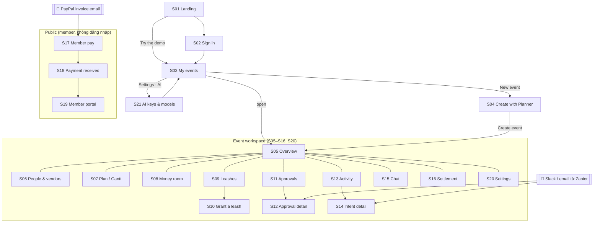
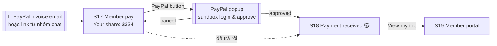
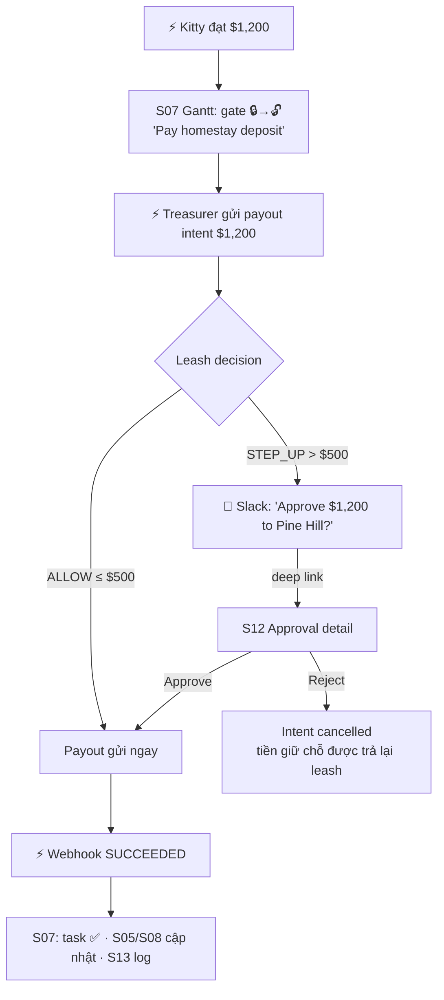
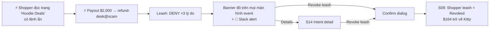

# 23 — User Screen Flow

## 1. "User screen flow" là gì?

**User screen flow** (còn gọi là *screen flow* hay *UI flow*) là bản mô tả **người dùng đi qua những màn hình nào, theo thứ tự nào, và hành động nào đưa họ từ màn hình này sang màn hình khác** để hoàn thành một mục tiêu.

Nó trả lời bốn câu hỏi cho từng bước:
1. **Đang ở màn hình nào?** (route, tên màn hình)
2. **Người dùng thấy gì?** (thông tin, trạng thái)
3. **Người dùng làm gì?** (bấm, nhập, chọn)
4. **Hệ thống làm gì, và người dùng được đưa tới đâu tiếp theo?** (API, agent, PayPal, màn hình kế tiếp)

### Khác gì với các tài liệu khác?

| Tài liệu | Trả lời câu hỏi | Ở đâu |
|---|---|---|
| **Sitemap** | App có những màn hình nào, lồng nhau ra sao? | §4 |
| **User story** | Người dùng muốn gì và vì sao? | [04-product-spec.md](04-product-spec.md) §3 |
| **User flow** (nghiệp vụ) | Các bước nghiệp vụ, không quan tâm giao diện | [04-product-spec.md](04-product-spec.md) §4 |
| **Wireframe / mockup** | Một màn hình trông như thế nào? | [15-ui-ux.md](15-ui-ux.md) §3 |
| **User screen flow** (file này) | **Đi từ màn hình nào sang màn hình nào, bằng hành động gì, qua những trạng thái nào?** | File này |
| **Sequence diagram** | Các service gọi nhau thế nào? | [06-architecture.md](06-architecture.md) §4 |

### Vì sao Kitty cần tài liệu này?
- **Cho người code:** biết cần những route nào, mỗi route có những trạng thái nào (empty, loading, error, realtime), và nút nào dẫn tới đâu. Không phải đoán.
- **Cho video demo:** kịch bản video ([19](19-demo-and-submission.md)) đi đúng theo các flow ở đây, nên mỗi cảnh quay là một đoạn flow đã được thiết kế.
- **Cho judges:** tiêu chí **Design** chấm "trải nghiệm hoàn chỉnh, mạch lạc". Screen flow là cách kiểm tra không có ngõ cụt: màn hình nào cũng có lối đi tiếp, lỗi nào cũng có đường lui.
- **Riêng với Kitty:** nhiều thứ xảy ra **không do người dùng bấm** (webhook PayPal về, agent tự hành động, leash bị chặn). Screen flow phải chỉ rõ những sự kiện đó **hiện lên màn hình nào, bằng cách nào**.

### Ký hiệu dùng trong file
| Ký hiệu | Nghĩa |
|---|---|
| `S03` | Mã màn hình (xem bảng §3) |
| `[Nút]` | Hành động người dùng |
| ⚡ | Sự kiện hệ thống tự đến (webhook, agent, realtime) |
| 🔔 | Thông báo ngoài app (Slack, email) có deep link quay lại app |
| ⟶ | Chuyển màn hình |

---

## 2. Người dùng và điểm vào

| Persona             | Đăng nhập?                             | Điểm vào app                                                                   | Mục tiêu chính                                  |
| ------------------- | -------------------------------------- | ------------------------------------------------------------------------------ | ----------------------------------------------- |
| **Organizer** (Mai) | Có (email + password, hoặc demo login) | Landing `/` ⟶ `/events`                                                        | Tạo event, thu tiền, cấp leash, duyệt, theo dõi |
| **Member** (Tuấn)   | **Không**                              | Email invoice của PayPal, link `/pay/:requestId`, hoặc link portal `/m/:token` | Trả phần của mình, xem lịch trình, nhận refund  |
| **Vendor**          | Không vào app                          | Email Payout của PayPal                                                        | Nhận tiền                                       |
| **Judge**           | Có (tài khoản `judge1..3@kitty.demo`)  | Landing `/` ⟶ playground event                                                 | Tự thử toàn bộ flow trên sandbox                |

---

## 3. Danh mục màn hình (screen inventory)

| ID | Route | Màn hình | Ai | Auth | Mục đích | Thành phần chính |
|---|---|---|---|---|---|---|
| S01 | `/` | Landing | Tất cả | Không | Giới thiệu, đăng nhập, "Try the demo" | Hero, 3 bước "How it works", nút demo login |
| S02 | `/sign-in` | Sign in | Organizer, Judge | Không | Đăng nhập | Better Auth form |
| S03 | `/events` | My events | Organizer | Có | Danh sách event, tạo mới | Event cards (Kitty balance, trạng thái) |
| S04 | `/events/new` | Create with Planner | Organizer | Có | Mô tả event bằng chat → nhận plan | Chat, Plan Review panel |
| S05 | `/events/:id` | Overview | Organizer | Có | Bức tranh tổng: tiền, alerts, agents, việc tiếp theo | KPI tiles, alert banners, agent list, "Next up" |
| S06 | `/events/:id/people` | People & vendors | Organizer | Có | Members, vendors, verify vendor | 2 bảng, nút Verify |
| S07 | `/events/:id/plan` | Plan (Gantt) | Organizer | Có | Timeline, payment gates | Bryntum Gantt |
| S08 | `/events/:id/money` | Money room | Organizer | Có | Dashboard tiền, hỏi analyst | AG Studio |
| S09 | `/events/:id/leashes` | Leashes | Organizer | Có | Cấp, xem, pause, revoke leash; max possible loss | Leash cards, cây delegation, (Scheduler) |
| S10 | `/events/:id/leashes/new` | Grant a leash (sheet) | Organizer | Có | Tạo leash | Preset picker, form, "Explain this leash" |
| S11 | `/events/:id/approvals` | Approval inbox | Organizer | Có | Duyệt step-up | Approval cards có countdown |
| S12 | `/events/:id/approvals/:apr` | Approval detail | Organizer | Có | Duyệt một yêu cầu (đích của deep link Slack) | Số tiền, payee, leash, reason, Approve/Reject |
| S13 | `/events/:id/activity` | Activity | Organizer | Có | Audit timeline | Timeline có filter |
| S14 | `/events/:id/activity/:intent` | Intent detail | Organizer | Có | Chi tiết một intent: decision, reasons, PayPal refs | JSON viewer, reason list |
| S15 | `/events/:id/chat` | Chat with agents | Organizer | Có | Giao việc cho agents | Chat + cards (product, decision, plan diff, live view) |
| S16 | `/events/:id/settle` | Settlement | Organizer | Có | Quyết toán, refund | Bảng refund preview, nút Settle |
| S17 | `/pay/:requestId` | Member pay | Member | Không | Trả phần góp | Số tiền, nút PayPal, giải thích tiền dùng vào đâu |
| S18 | `/pay/:requestId/done` | Payment received | Member | Không | Xác nhận | Mèo vui, link portal |
| S19 | `/m/:token` | Member portal | Member | Token | Đã góp gì, lịch trình, refund | Tóm tắt, (Bryntum Calendar) |
| S20 | `/events/:id/settings` | Event settings | Organizer | Có | Sửa thông tin, đóng event, reset playground (judge) | Form |
| S21 | `/settings/ai` | **AI keys & models** (BYOK) | Organizer, Judge | Có | Thêm/xoá API key, chọn model default + theo vai, xem usage | Provider picker, key input, Test connection, model dropdowns, usage chart |

**Thành phần toàn cục (không phải màn hình riêng):**
- **Top bar:** tên event, 🔔 notification bell (số chưa đọc), badge số approvals đang chờ.
- **Event nav (sidebar hoặc tabs):** Overview · Plan · Money · Leashes · Approvals · Activity · Chat · People.
- **Global alert banner:** hiện trên mọi màn hình của event khi có DENY nghiêm trọng hoặc approval sắp hết hạn.
- **Toast:** sự kiện realtime nhỏ ("Tuan paid $334 🎉").

---

## 4. Sitemap

---

## 5. Các luồng màn hình

### F0 — Kết nối AI của riêng bạn (BYOK)
**Ai:** Organizer · **Khi nào:** lần đầu vào app (bước trong checklist), hoặc bất kỳ lúc nào từ menu tài khoản ⟶ Settings · AI. **Mục tiêu:** agents chạy bằng key và model người dùng chọn. App không cung cấp model.

| # | Màn hình | Người dùng thấy | Người dùng làm | Hệ thống làm | ⟶ |
|---|---|---|---|---|---|
| 1 | S03 / S05 | Banner: *"Agents are off — bring your own AI key to let them work."* `[Add AI key]` `[Continue without AI]` | `[Add AI key]` | — | S21 |
| 2 | S21 | Chọn provider: Anthropic · OpenAI · Google · OpenRouter · OpenAI-compatible (base URL). Mỗi provider có link "Where do I get a key?" | Chọn **Anthropic**, dán key | — | S21 |
| 3 | S21 | `[Test connection]` | Bấm | Agents service gọi provider: list models + 1 tool call nhỏ | S21 |
| 4 | S21 | ✓ "Connected · sk-ant-…a1F9". Dropdown model đã có danh sách. Gợi ý: Planner `claude-opus-5-5`, các vai khác `claude-sonnet-5-5` / `claude-haiku-5-5` | Giữ gợi ý hoặc đổi từng vai → `[Save]` | Lưu key (mã hoá) + model settings | S21 / quay lại trang trước |
| 5 | S05 | Banner biến mất; trên card mỗi agent hiện model đang dùng | — | — | — |

**Trạng thái và lỗi:**
- Key sai → ✗ "Invalid key"; không lưu gì.
- Model không hỗ trợ tool calling → cảnh báo "This model can't use tools — agents won't work with it", không cho chọn cho các vai cần tools.
- Key hết credit / bị giới hạn (429) giữa chừng → agent run dừng an toàn, banner đỏ nhẹ *"Your AI key hit a limit"* `[Open AI settings]`. Tiền không bị ảnh hưởng.
- `[Continue without AI]` → **manual mode**: mọi tính năng tiền vẫn dùng được, chỉ agents tắt ([24](24-byok-ai-models.md) §6).
- Tài khoản demo/judge: S21 hiện *"Using Kitty's demo key (limited)"*, vẫn cho thêm key riêng.

---

### F1 — Đăng nhập và lần đầu vào app
**Ai:** Organizer / Judge · **Mục tiêu:** vào được workspace trong ≤ 2 bước.

| # | Màn hình | Người dùng thấy | Người dùng làm | Hệ thống làm | ⟶ |
|---|---|---|---|---|---|
| 1 | S01 Landing | Tagline "Let your agents spend. On a leash.", 3 bước How it works | `[Try the demo]` hoặc `[Sign in]` | Demo: đăng nhập bằng tài khoản demo | S03 hoặc S02 |
| 2 | S02 Sign in | Form email/password, gợi ý tài khoản judge | Nhập, `[Sign in]` | Better Auth tạo session | S03 |
| 3 | S03 My events | Lần đầu: empty state "No events yet" + `[Plan an event with AI]`. Judge: thấy sẵn "Judge Playground N" | Chọn event hoặc `[New event]` | — | S05 hoặc S04 |

**Trạng thái:** sai mật khẩu → lỗi dưới form, không xoá email đã nhập. Session hết hạn ở bất kỳ màn hình nào → về S02 rồi quay lại đúng trang cũ (`?next=`).

---

### F2 — Tạo event với Planner
**Ai:** Organizer · **Mục tiêu:** từ một câu mô tả có ngay kế hoạch, ngân sách, timeline.

| # | Màn hình | Người dùng thấy | Người dùng làm | Hệ thống làm | ⟶ |
|---|---|---|---|---|---|
| 1 | S04 Create | Ô chat lớn, 3 prompt mẫu (offsite, trip, wedding) | Gõ: *"Team offsite in Da Lat, Dec 20–22, 12 people, budget $4,000…"* → `[Send]` | Gửi tới Planner (agents) | S04 (đang chạy) |
| 2 | S04 (Planner đang chạy) | Planner hiện từng bước: "Drafting budget… Building timeline…" (stream) | Chờ (≈10–20s) | Planner trả structured plan | S04 (Plan Review) |
| 3 | S04 Plan Review | Panel bên phải: thông tin event, **budget lines** (lodging $1.800, transport $450…), **mức góp $334/người**, danh sách task có 🔒 gate, vendors đề xuất (nhãn *unverified*) | Sửa trực tiếp (số tiền, ngày, xoá task) hoặc chat thêm "make it 15 people" | Chat thêm → Planner trả **plan diff** (dòng xanh/đỏ) | S04 |
| 4 | S04 Plan Review | Nút `[Create event]` | `[Create event]` | Tạo event, kitty (balance 0), tasks, budget lines, 4 agents + keypair | **S05 Overview** |
| 5 | S05 Overview | Lần đầu: checklist "Get started": ① Add members ② Verify vendors ③ Collect money ④ Grant leashes | Bấm bước ① | — | S06 |

**Trạng thái và lỗi:**
- Planner lỗi hoặc timeout → thông báo "Planner couldn't finish — try again or start from a blank plan" + `[Retry]` `[Start blank]`.
- Prompt thiếu dữ liệu (không có ngân sách) → Planner hỏi lại trong chat, không tự bịa con số.
- Rời trang khi chưa Create → draft được giữ (local), quay lại thấy lại plan.

---

### F3 — Thêm members và xác nhận vendors
**Ai:** Organizer · **Mục tiêu:** có danh sách người góp tiền và người nhận tiền **đã được xác nhận**.

| # | Màn hình | Người dùng thấy | Người dùng làm | Hệ thống làm | ⟶ |
|---|---|---|---|---|---|
| 1 | S06 People | Bảng Members (trống) + `[Add members]` | Dán danh sách email hoặc thêm từng người; chỉnh share weight | Lưu members, sinh `member_token` | S06 |
| 2 | S06 Vendors | Vendors do Planner đề xuất, nhãn **Unverified** vàng | Kiểm email PayPal → `[Verify]` | `verified=true` → vendor **đủ điều kiện** vào allowlist leash | S06 |
| 3 | S06 | Checklist trên S05 tick ①② | `[Back to overview]` | — | S05 |

**Vì sao bước Verify quan trọng:** đây là chỗ con người giữ quyền cuối với danh sách người nhận tiền. Agent có thể đề xuất vendor nhưng không bao giờ tự xác nhận (bất biến #12 trong [AGENTS.md](../AGENTS.md)).

**Lỗi:** email trùng → gộp; email sai định dạng → báo inline; xoá vendor đang có trong một leash active → hỏi xác nhận và gỡ payee khỏi leash đó.

---

### F4 — Thu tiền (phía organizer)
**Ai:** Organizer · **Mục tiêu:** gửi invoice cho mọi member và theo dõi ai đã trả.

| # | Màn hình | Người dùng thấy | Người dùng làm | Hệ thống làm | ⟶ |
|---|---|---|---|---|---|
| 1 | S05 Overview | Bước ③ "Collect money": "12 members × $334" | `[Collect money]` | Mở xác nhận | S05 (dialog) |
| 2 | Dialog | Tóm tắt: 12 invoice, hạn trả, mẫu tin nhắn; ghi chú "Collector agent sends these with its own leash" | `[Send invoices]` | Tạo leash Collections (nếu chưa có) → Collector gọi `leash_create_invoice` ×12 → PayPal gửi invoice | S06 (tab Members) |
| 3 | S06 Members | Cột Status chuyển `draft → sent` lần lượt (realtime) | Chờ, hoặc `[Open invoice]` để xem payer-view link | — | S06 |
| 4 | ⚡ Webhook `INVOICING.INVOICE.PAID` | Toast "Tuan paid $334 🎉"; dòng Tuan → **Paid**; Kitty tile trên S05 tăng; gauge trên S08 nhích | — | Ledger contribution, outbox → SSE | (giữ màn hình hiện tại) |
| 5 | ⚡ Collector reminder (cron) | Activity: "Collector sent a friendly reminder to Linh (3 days left)"; Slack/email tới Linh | Có thể `[Pause reminders]` cho từng người | Zapier MCP gửi tin | — |

**Lỗi:** invoice tạo thất bại → dòng member đỏ "Couldn't send — Retry"; webhook chậm → nút `[Sync now]` trên S06.

---

### F5 — Member trả tiền (phía member)
**Ai:** Member · **Mục tiêu:** trả xong trong ≤ 3 lần chạm, không cần tài khoản Kitty.

| # | Màn hình | Người dùng thấy | Người dùng làm | Hệ thống làm | ⟶ |
|---|---|---|---|---|---|
| 1 | 📧 Email | Invoice từ "Kitty — Da Lat Team Offsite" | Bấm link | — | Trang invoice của PayPal **hoặc** S17 |
| 2 | S17 Member pay | Tên event, **Your share $334**, hạn, "What's this for?" (lấy từ budget lines), "Any surplus is refunded automatically" | Bấm nút PayPal | JS SDK v6 mở popup | PayPal popup |
| 3 | PayPal popup | Đăng nhập sandbox, approve | Approve | Order capture (hoặc invoice paid) | S18 |
| 4 | S18 Done | Mèo vui, "You're in! $334 received", số người đã góp (9/12) | `[View my trip]` | — | S19 |
| 5 | S19 Portal | Đã góp $334, lịch trình (Calendar), trạng thái refund (sau event) | — | — | — |

**Trạng thái:** link đã trả → S17 tự chuyển sang S18 (không trả hai lần); link hết hạn hoặc invoice bị huỷ → "This request is no longer active — ask Mai"; PayPal lỗi → ở lại S17, báo "Payment didn't go through, nothing was charged".

---

### F6 — Cấp leash cho agent
**Ai:** Organizer · **Mục tiêu:** giao quyền chi tiêu cho một agent, hiểu rõ rủi ro tối đa.

| # | Màn hình | Người dùng thấy | Người dùng làm | Hệ thống làm | ⟶ |
|---|---|---|---|---|---|
| 1 | S09 Leashes | Mỗi agent một card; agent chưa có leash ghi "No leash — can't spend"; tile **Max possible loss: $0** | `[Grant leash]` trên card Treasurer | — | S10 |
| 2 | S10 Grant (sheet) | 4 presets (Vendor payments, Merch run, Collections, Planning) | Chọn **Vendor payments** | Điền sẵn form theo preset | S10 |
| 3 | S10 | Form: allocation (thanh trượt, tối đa = Kitty available), per-payment, daily, step-up above, payees (chỉ vendor **verified**), categories, expiry. Bên dưới: **"Explain this leash"** — *"Treasurer can pay up to $1,200 at a time, $2,500 in total, only to Pine Hill Homestay, Highland Bus and BBQ Garden, for lodging, transport and food, until Dec 25. Anything over $500 needs your approval."* | Chỉnh, rồi `[Grant leash]` | Gateway kiểm allocation ≤ Kitty available → ledger allocate → leash active | S09 |
| 4 | S09 | Card Treasurer có thanh tiền (available/held/spent), chip payees, countdown hết hạn; **Max possible loss: $2,500** | — | — | — |

**Lỗi:** allocation > Kitty available → slider bị chặn ở mức tối đa, kèm gợi ý "Collect more first"; chưa có vendor verified → payees trống, có link sang S06.

---

### F7 — Gate mở ⟶ Treasurer trả vendor ⟶ step-up approval
**Ai:** Organizer (phần lớn là hệ thống tự chạy) · **Mục tiêu:** vendor được trả đúng lúc, organizer chỉ cần một chạm.

| # | Màn hình | Người dùng thấy | Người dùng làm | Hệ thống làm |
|---|---|---|---|---|
| 1 | (bất kỳ) | Toast "Kitty reached $1,200 — Pay homestay deposit is unlocked 🔓" | — | Gate check sau webhook |
| 2 | S07 Gantt | Gate milestone đổi 🔒 xám → 🔓 cam (animation); task kế tiếp hết bị chặn | Có thể bỏ qua | — |
| 3 | 🔔 Slack | "💼 Treasurer wants to pay **Pine Hill Homestay $1,200** (deposit). Needs your OK — expires in 15 min. [Review in Kitty]" | Bấm link | Badge approvals trên top bar = 1 |
| 4 | S12 Approval | **$1,200** lớn; payee ✓ verified; leash "Vendor payments" (available $2,500 → $1,300 sau khi trả); lý do: "over your $500 step-up"; task liên quan; *agent's note (unverified)*; countdown | `[Approve]` | Gateway thực thi payout |
| 5 | S12 | Trạng thái: Approved → Sending to PayPal… → **Paid ✅** (realtime) | `[Back to plan]` | Webhook → settled |
| 6 | S07 | Task "Pay homestay deposit" ✅, task phụ thuộc tự dời lịch nếu cần | — | — |

**Edge cases:**
- Hết 15 phút chưa duyệt → S12 hiện "Expired — Treasurer will ask again"; tiền giữ chỗ được trả lại leash.
- Payout FAILED/RETURNED → toast đỏ; S07 task bị flag "Moved by Treasurer: payout failed"; S14 có lý do từ PayPal.
- Payout UNCLAIMED → S12/S14 hiện cảnh báo + `[Cancel payout]`.
- Mở deep link khi chưa đăng nhập → S02 rồi quay lại đúng S12.

---

### F8 — Shopper mua đồ bằng sub-leash
**Ai:** Organizer + Planner + Shopper · **Mục tiêu:** giao việc mua sắm với rủi ro nhỏ nhất.

| # | Màn hình | Người dùng thấy | Người dùng làm | Hệ thống làm |
|---|---|---|---|---|
| 1 | S15 Chat | — | Gõ "@shopper get 12 matching hoodies under $30" | Planner tạo **sub-leash** $500 / merch / 48h cho Shopper |
| 2 | S15 | **Decision card**: "Planner gave Shopper a $500 sub-leash (merch only, Hoodie Lab only, 48h)" | — | Shopper tìm qua Channel3 |
| 3 | S15 | **3 product cards** (ảnh, giá, retailer thật từ Channel3) + nhãn "Fulfilled by demo vendor (sandbox)" | `[Choose]` một mẫu | Shopper tạo payout intent $336 |
| 4 | S15 | Decision card xanh **ALLOW** — "$336 to Hoodie Lab · $164 left on this leash" | — | Payout → webhook → settled |
| 5 | S09 | Cây delegation: Planner → Shopper ($164 left); Max possible loss giảm | — | — |

**Edge:** Shopper xin sub-leash rộng hơn leash của Planner → card đỏ `DELEGATION_EXCEEDS_PARENT`, chi tiết từng field.

---

### F9 — Prompt injection bị chặn ⟶ thu hồi leash
**Ai:** Organizer · **Mục tiêu:** thấy ngay mối nguy, hiểu là không mất tiền, khoá lại trong một chạm.

| # | Màn hình | Người dùng thấy | Người dùng làm | Hệ thống làm |
|---|---|---|---|---|
| 1 | (bất kỳ) | **Banner đỏ**: "🚨 Shopper tried to pay refund-desk@scam.example $2,000 — **blocked by its leash**. Max possible loss $164 · Actual loss $0." `[Details]` `[Revoke leash]` | `[Details]` | — |
| 2 | S14 Intent detail | Decision **DENY** với 3 lý do viết thành câu (payee không được duyệt, vượt mức mỗi lần, vượt số dư); nguồn: "Shopper read hoodie-deals.demo (untrusted content)"; JSON đầy đủ | `[Revoke leash]` | — |
| 3 | Confirm dialog | "Revoke Shopper's leash? $164 goes back to the kitty. Any pending requests are cancelled." | `[Revoke]` | Gateway revoke, cascade, ledger trả tiền về |
| 4 | S09 | Card Shopper: **Revoked** (xám), $0 available; Kitty +$164 | — | Agent Shopper nhận event `leash.revoked` và dừng |

**Lưu ý thiết kế:** banner nói **"blocked"** trước, rồi mới nói "tried". Mục tiêu cảm xúc là *an tâm*, không phải hoảng sợ.

---

### F10 — Hỏi dashboard
**Ai:** Organizer · **Màn hình:** S08 Money room.

| # | Người dùng thấy | Người dùng làm | Hệ thống làm |
|---|---|---|---|
| 1 | Kitty Gauge, Who still owes, Spend by category, Leash usage, Blocked attempts | Gõ vào "Ask Kitty Analyst…": *"Which leash was blocked the most this week?"* | Studio Agent Framework truy vấn data source read-only |
| 2 | Widget mới xuất hiện, có viền highlight | `[Keep]` (lưu vào layout) hoặc `[Discard]` | Lưu layout |

Click một con số bất kỳ ⟶ S13 Activity đã lọc sẵn theo con số đó (tiền luôn kèm nguồn gốc).

---

### F11 — Quyết toán
**Ai:** Organizer + Treasurer · **Màn hình:** S16.

| # | Người dùng thấy | Người dùng làm | Hệ thống làm |
|---|---|---|---|
| 1 | S05 sau ngày kết thúc: banner "Trip's over — settle up?" | `[Settle]` | Treasurer gọi settlement preview |
| 2 | S16: tổng thu, tổng chi, **dư $180**, bảng refund từng người ($15 × 12), leash nào còn tiền sẽ bị thu hồi | `[Refund & close]` | Step-up tự động (organizer chính là người duyệt) → refunds |
| 3 | Từng dòng chuyển `pending → refunded` (realtime) | — | Webhooks `CAPTURE.REFUNDED` |
| 4 | Event `settled`, mèo ngủ 😴; members thấy refund ở S19 | — | — |

---

### F12 — Judge playground
| # | Màn hình | Người dùng làm |
|---|---|---|
| 1 | S01 → S02 | Đăng nhập `judge1@kitty.demo` |
| 2 | S03 | Mở "Judge Playground 1" (đã có members, vendors verified, Kitty $2.000, leashes) |
| 3 | S05 | Banner hướng dẫn: "Try: ① pay as a member (sandbox buyer below) ② approve a payout ③ run the injection test" kèm nút chạy từng kịch bản |
| 4 | S20 | `[Reset playground]` để về trạng thái ban đầu |

---

## 6. Trạng thái của từng màn hình

| Màn hình | Empty | Loading | Error | Realtime cập nhật khi |
|---|---|---|---|---|
| S03 Events | "No events yet" + CTA | Skeleton cards | Retry | — |
| S21 AI settings | "No AI key yet — agents are off" + chọn provider | Test connection spinner | Invalid key / no tool support / unreachable base URL | Status key đổi (`invalid`, `rate_limited`) |
| S04 Create | 3 prompt mẫu | Planner stream từng bước | Retry / Start blank | Plan diff |
| S05 Overview | Checklist Get started | Skeleton tiles | Tile lỗi riêng lẻ, phần khác vẫn hiện | Mọi domain event |
| S06 People | "Add your first member" | Skeleton rows | Inline per row | `kitty.funds_received`, trạng thái invoice |
| S07 Plan | "Ask Planner to build a timeline" | Gantt skeleton | Fallback dạng bảng nếu Gantt lỗi license | Gate mở, task done/moved |
| S08 Money | Gauge 0% + "No money yet" | Widget skeleton | Widget lỗi riêng lẻ | Ledger thay đổi |
| S09 Leashes | "No leash — agents can't spend" | Skeleton | — | created/revoked/paused/expired, usage |
| S11 Approvals | "Nothing waiting 🎉" | Skeleton | — | requested/expired/decided |
| S13 Activity | "Nothing yet" | Infinite scroll loader | Retry | Mọi event |
| S15 Chat | Gợi ý @mention | Typing indicator theo agent | Message lỗi + Retry | Agent messages |
| S17 Pay | — | Nút PayPal loading | Lỗi PayPal, không trừ tiền | Đã trả → S18 |

Nguyên tắc: **lỗi ở một widget không làm sập cả màn hình**; mọi trạng thái lỗi đều có hành động tiếp theo (Retry, Sync now, link hướng dẫn).

---

## 7. Thông báo và deep link

| Sự kiện | Trong app | Ngoài app (Zapier) | Deep link tới |
|---|---|---|---|
| Approval requested | Badge + banner vàng + toast | Slack DM organizer | S12 |
| Approval sắp hết hạn (≤ 3') | Banner vàng nhấp nháy nhẹ | — | S12 |
| Intent DENY severity high | **Banner đỏ** toàn event | Slack alert | S14 |
| Member paid | Toast | (tuỳ chọn) Slack kênh nhóm | S06 |
| Payout settled | Toast + task ✅ | — | S14 |
| Payout failed / unclaimed | Toast đỏ | Slack | S14 |
| Leash sắp hết hạn (24h) | Chip đỏ trên card | — | S09 |
| Reminder gửi cho member | Dòng trong Activity | Email/Slack cho member | S17 (cho member) |
| Trip ended | Banner "Settle up?" | Email organizer | S16 |

Mọi deep link đi qua `/events/:id/...`; chưa đăng nhập → S02 → quay lại đúng link.

---

## 8. Bản đồ realtime (domain event → màn hình)

| Domain event | S05 | S06 | S07 | S08 | S09 | S11/S12 | S13 | S15 |
|---|---|---|---|---|---|---|---|---|
| `kitty.funds_received` | ✓ tiles | ✓ status | ✓ gates | ✓ | ✓ max slider | | ✓ | |
| `kitty.allocated` | ✓ | | | ✓ | ✓ | | ✓ | |
| `leash.created/revoked/paused/expired` | ✓ agents | | | ✓ | ✓ | ✓ (cancel) | ✓ | ✓ card |
| `leash.intent_decided` | | | | ✓ blocked | ✓ usage | | ✓ | ✓ card |
| `leash.intent_denied` (high) | ✓ banner | | | ✓ | ✓ | | ✓ | ✓ |
| `leash.approval_requested` | ✓ banner | | | | | ✓ | ✓ | |
| `leash.intent_settled/failed` | ✓ | | ✓ task | ✓ | ✓ | ✓ status | ✓ | ✓ |
| `kitty.refunded` | ✓ | ✓ | | ✓ | | | ✓ | |

Cơ chế: SSE `/api/events/:id/stream` (xem [06-architecture.md](06-architecture.md) §7); mỗi màn hình đăng ký các loại event nó cần và gọi `router.refresh()` hoặc cập nhật store cục bộ.

---

## 9. Liên kết flow ↔ user story ↔ video

| Flow | User stories ([04](04-product-spec.md)) | Cảnh trong video ([19](19-demo-and-submission.md)) |
|---|---|---|
| F0 | M13, M14 | 3 giây ở S21: *"bring any model"* |
| F1 | — | (không quay) |
| F2 | M1 | 0:22–0:45 |
| F3 | M7 (verify payees) | (lướt nhanh) |
| F4 + F5 | M2, M3, S2 | 0:45–1:05 |
| F6 | M4, M10 | 1:05–1:15 |
| F7 | M6, M7, M8 | 1:15–1:30 |
| F8 | S1, S4 | 1:30–1:45 |
| F9 | M10, M11, M12 | 1:45–2:05 |
| F10 | M9, S3 | 2:05–2:25 |
| F11 | S5 | 2:40–2:52 |
| F12 | (testing access cho judges) | — |
