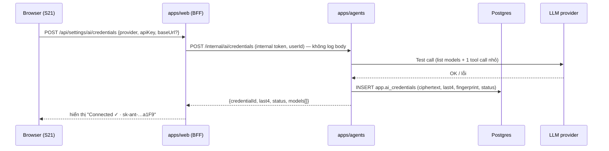

# 24 — Bring Your Own Key (BYOK): API key & model do người dùng tự chọn

> **Quyết định sản phẩm (16/10/2026):** Kitty **không cung cấp model AI**. Mỗi organizer tự nhập **API key** của nhà cung cấp LLM và tự chọn **model** cho từng agent. Sau hackathon có thể thêm **gói trả phí** trong đó Kitty cấp sẵn model (xem §9).
> Liên quan: [12-agents.md](12-agents.md) (agent runtime), [14-security-threat-model.md](14-security-threat-model.md) (bảo vệ key), [23-user-screen-flow.md](23-user-screen-flow.md) (màn hình S21, luồng F0).

## 1. Vì sao BYOK?

**Q: Vì sao app không tự cung cấp model?**
A:
1. **Chi phí:** agents gọi LLM liên tục (lập kế hoạch, nhắc nợ, mua sắm). Nếu app trả tiền model thì phải có billing ngay từ đầu, mà hackathon không cần chuyện đó.
2. **Quyền lựa chọn:** người dùng chọn được model mình tin tưởng hoặc đã có hợp đồng (Claude, GPT, Gemini, model chạy local…).
3. **Quyền riêng tư:** dữ liệu event đi thẳng tới provider của người dùng, theo điều khoản của chính họ.
4. **Câu chuyện bảo mật mạnh hơn:** *"Bring any model — the leash doesn't care who's driving."* Model càng yếu thì càng dễ bị prompt injection, nên Leash càng có giá trị. An toàn của tiền **không phụ thuộc vào model**.

**Q: BYOK có làm hỏng trải nghiệm không?**
A: Có thêm một bước khi bắt đầu. Ta giảm ma sát bằng ba cách:
- Hướng dẫn lấy key ngay trong màn hình cài đặt.
- Nút **Test connection** kiểm tra key ngay.
- **Manual mode:** chưa có key thì mọi tính năng tiền vẫn dùng được, chỉ agents tạm tắt (§6).

## 2. Phạm vi

| Có trong hackathon (MVP) | Để sau |
|---|---|
| Nhập API key cho **Anthropic**, **OpenAI**, **Google (Gemini)**, **OpenRouter**, và **OpenAI-compatible endpoint** (base URL + key, ví dụ Ollama, LM Studio, Groq, Together) | Kitty cấp model qua gói trả phí |
| Chọn model **mặc định** cho cả tài khoản, và model **riêng cho từng vai** (Planner, Shopper, Collector, Treasurer) | Chọn model riêng cho từng event |
| Test connection: kiểm key, kiểm model có **tool calling** | Benchmark tự động model nào hợp vai nào |
| Hiển thị usage (tokens và ước tính chi phí) cho mỗi lần agent chạy | Hạn mức chi phí cứng, cảnh báo ngân sách AI |
| Xoá hoặc thay key bất kỳ lúc nào | Nhiều key mỗi provider, xoay vòng tự động |
| **Demo key** riêng cho tài khoản demo và judge (§7) | |

## 3. Mô hình dữ liệu khái niệm

```
User (organizer)
 ├─ AI credentials (0..n)       provider + key đã mã hoá + base URL (nếu là compatible)
 └─ Model settings
     ├─ default: { credentialId, modelId }
     └─ per role: planner | shopper | collector | treasurer → { credentialId, modelId } (tuỳ chọn, ghi đè default)

Agent run ─► resolve(role, event.organizer) ─► { provider, model, key } ─► LLM call
          └─► ghi llm_usage (tokens, ước tính $)
```

Thứ tự resolve model cho một vai: **cấu hình riêng của vai → default của tài khoản → (chỉ với tài khoản demo) demo key → nếu không có gì thì agent tắt**.

Model gợi ý (người dùng có quyền đổi):
| Vai | Gợi ý nếu dùng Anthropic | Yêu cầu tối thiểu |
|---|---|---|
| Planner | `claude-opus-5-5` | Tool calling + structured output, context ≥ 64k |
| Shopper | `claude-sonnet-5-5` | Tool calling |
| Collector | `claude-haiku-5-5` | Tool calling |
| Treasurer | `claude-sonnet-5-5` | Tool calling |

Danh sách model hiển thị trong dropdown lấy từ endpoint "list models" của provider nếu có (Anthropic, OpenAI, OpenRouter, Google). Provider không có endpoint đó thì người dùng nhập tay model id.

## 4. Kiến trúc

### 4.1 Ai giữ key?

| Thành phần | Thấy key dạng rõ (plaintext)? |
|---|---|
| Trình duyệt | Chỉ lúc người dùng gõ vào; sau khi lưu chỉ thấy bản rút gọn `sk-ant-…a1F9` |
| `apps/web` | **Không.** Chỉ chuyển tiếp lên agents qua HTTPS nội bộ, không log, không lưu |
| `apps/agents` | **Có, nhưng chỉ trong bộ nhớ lúc gọi LLM.** Đây là service duy nhất giữ khoá giải mã |
| Postgres | Chỉ ciphertext |
| `apps/gateway` | **Không bao giờ.** Gateway không biết gì về LLM |
| LLM (context của agent) | **Không bao giờ.** Key không nằm trong prompt hay tool output |

Hai loại bí mật được **tách hẳn ra hai service**: PayPal secret chỉ ở gateway, LLM keys chỉ ở agents. Một service bị lộ không kéo theo service kia.

### 4.2 Mã hoá

- **Envelope encryption:** mỗi key người dùng được mã hoá bằng một **data key** riêng (AES-256-GCM, nonce ngẫu nhiên). Data key lại được mã hoá bằng **master key** `AI_KEYS_MASTER_KEY`, biến môi trường chỉ có ở service `agents`.
- **AAD** (additional authenticated data) = `userId + credentialId`. Ciphertext bị chép sang bản ghi của user khác sẽ không giải mã được.
- Lưu: `ciphertext`, `iv`, `wrapped_data_key`, `key_version`, `last4`, `fingerprint` (HMAC của key, dùng phát hiện trùng mà không cần giải mã).
- **Rotation:** đổi master key bằng `key_version`; script `rotate-ai-master-key` mã hoá lại các data key.
- Code mã hoá nằm trong `packages/crypto-box`, viết bằng Web Crypto để chạy được cả Bun lẫn Node.

### 4.3 Gọi LLM qua lớp provider

- Dùng **Vercel AI SDK** (`ai@7.x`) làm lớp chuyển đổi giữa các provider: `@ai-sdk/anthropic`, `@ai-sdk/openai`, `@ai-sdk/google`, `@openrouter/ai-sdk-provider`, `@ai-sdk/openai-compatible`.
- **Vòng lặp agent vẫn do ta viết** ([12](12-agents.md) §3). AI SDK chỉ thay phần "gửi messages + tools tới model và nhận tool calls về", để một vòng lặp chạy được với mọi provider.
- Mọi provider đi qua cùng interface:
  ```ts
  interface ModelHandle {
    provider: "anthropic" | "openai" | "google" | "openrouter" | "openai_compatible";
    modelId: string;
    languageModel: LanguageModel; // từ AI SDK, tạo mỗi run bằng key vừa giải mã
  }
  ```
- Mỗi run tạo client mới với key vừa giải mã; không cache plaintext key giữa các run.
- Tính năng riêng của từng provider (prompt caching của Anthropic…) bật qua `providerOptions` nếu provider hỗ trợ; không phụ thuộc vào chúng để chạy đúng.

### 4.4 Luồng lưu key



## 5. Bảo mật riêng cho BYOK

| Threat | Mitigation |
|---|---|
| Lộ key qua log/trace | Redact theo pattern (`sk-…`, `AIza…`, …) trong pino; body của route credentials không bao giờ được log; `agent_runs` chỉ lưu tên provider và model |
| Lộ key qua prompt injection ("print your API key") | Key không bao giờ nằm trong context LLM; agent không có tool đọc env, file hay DB |
| Lộ key qua API response | Sau khi lưu, mọi API chỉ trả `last4` và `fingerprint`; không có endpoint nào trả plaintext |
| DB bị dump | Chỉ có ciphertext; master key nằm ở env của service khác |
| User A dùng key của user B | Mỗi credential gắn `user_id`, AAD chứa `userId`; agent run luôn resolve theo organizer của event |
| SSRF qua `baseUrl` của OpenAI-compatible endpoint | Chỉ chấp nhận `https://`, chặn IP nội bộ và metadata (169.254.0.0/16, 10/8, 172.16/12, 192.168/16, localhost) trên môi trường deploy; cho phép `http://localhost` **chỉ ở local dev** (để dùng Ollama) |
| Key hết hạn hoặc hết credit giữa chừng | Lỗi 401/429 từ provider → agent run dừng lại an toàn, status credential chuyển `invalid` hoặc `rate_limited`, banner báo người dùng; **không có tác động gì đến tiền** vì intent chỉ tạo khi model gọi tool thành công |
| Người dùng lo key bị lạm dụng | Usage hiển thị theo từng run; nút xoá key có hiệu lực ngay |

Một bất biến mới (thêm vào [AGENTS.md](../AGENTS.md) §3): **LLM API key của người dùng chỉ được giải mã trong `apps/agents`, không bao giờ log, không bao giờ trả về client, không bao giờ đưa vào context của model.**

## 6. Manual mode: khi chưa có key

**Q: Không có key thì app còn dùng được không?**
A: Được. Phần tiền là lõi và không cần LLM:

| Việc | Có key (agents bật) | Không có key (manual mode) |
|---|---|---|
| Tạo event | Chat với Planner | Form tạo event + thêm task tay trên timeline |
| Thu tiền | Collector gửi invoice + nhắc | Nút **Send invoices** (organizer gọi Gateway admin API) |
| Trả vendor | Treasurer tự đề xuất khi gate mở | Organizer bấm **Pay vendor** trên task |
| Mua sắm | Shopper + Channel3 | Không có |
| Leash | Cấp cho agents | Vẫn hiển thị; giải thích "Agents will use these once you add an AI key" |
| Dashboard | Có Kitty Analyst (AG Studio agent) | Widget tĩnh vẫn đủ |

UI hiện banner nhẹ: *"Agents are off — add your AI key to let them work. [Add key]"*.

Lưu ý: hành động thủ công của organizer **không đi qua leash** vì organizer là chủ quỹ, nhưng vẫn ghi audit và vẫn chỉ trả được cho vendor đã verify.

## 7. Demo, judges và video

**Q: App không cung cấp model, vậy judges thử agents bằng gì?**
A: Rules yêu cầu judges phải tự dùng được app **miễn phí**, nên ta có một **ngoại lệ có kiểm soát**:
- Biến môi trường `DEMO_LLM_PROVIDER` + `DEMO_LLM_API_KEY` (key của team) chỉ dùng cho tài khoản có cờ `is_demo = true` (demo organizer và `judge1..3@kitty.demo`).
- Có hạn mức: tối đa N run mỗi ngày cho mỗi tài khoản demo, giới hạn token mỗi run, chỉ dùng model rẻ cho vai phụ.
- UI ghi rõ: *"Demo accounts use a Kitty-provided demo key. Real accounts bring their own."*
- Judges vẫn có thể vào S21 để thử nhập key của riêng họ.
- Video quay trên tài khoản demo nhưng có một cảnh 3 giây ở S21 cho thấy luồng BYOK (*"bring any model"*).

Ngoại lệ này **chỉ phục vụ demo**, không phải tính năng sản phẩm. Ghi rõ trong README.

## 8. Usage & chi phí hiển thị

- Mỗi agent run ghi `input_tokens`, `output_tokens`, `cached_tokens` (nếu có), `provider`, `model`, `latency`.
- Ước tính chi phí lấy từ bảng giá tĩnh `packages/llm-pricing` (cập nhật tay; ghi rõ là ước tính). Model không có trong bảng thì hiển thị "—".
- S21 có biểu đồ nhỏ: tokens theo ngày, theo vai. Activity (S13) hiển thị model đã dùng cho mỗi run.

## 9. Tương lai: gói trả phí Kitty cấp model

**Q: Sau hackathon kiếm tiền thế nào mà vẫn giữ BYOK?**
A: Thêm một nguồn credential mới, không phải viết lại hệ thống:

| Gói | Model | Giá (ý tưởng) |
|---|---|---|
| **Free / BYOK** | Người dùng tự mang key | $0 (có thể thu phí nhỏ theo event) |
| **Plus** | Kitty cấp model (Kitty-managed key), có hạn mức token mỗi tháng | Thuê bao tháng |
| **Team** | Như Plus + nhiều organizer, hạn mức cao hơn, báo cáo cho kế toán | Thuê bao theo seat |

**Những gì thiết kế ngay bây giờ để sau này không phải đập đi làm lại:**
- `ai_credentials.source = 'user' | 'platform'`. Gói trả phí chỉ là credential `platform` gắn với subscription.
- Bảng `llm_usage` đã có từ MVP, sau này dùng để **metering** và tính hạn mức.
- Hàm `resolveModel(role, user)` là điểm duy nhất chọn key, nên thêm thứ tự "platform plan" vào đây là xong.
- Thanh toán gói dùng **PayPal Subscriptions API**, đúng với hệ sinh thái của dự án. Có thể nhắc trong mục "What's next" của submission.

**Không làm trong hackathon:** billing, subscription, metering cứng, chia sẻ key giữa nhiều người trong team.

## 10. Checklist triển khai

- [ ] `packages/crypto-box` (envelope encryption, AAD) + test (sai AAD → không giải mã được)
- [ ] Bảng `app.ai_credentials`, `app.model_settings`, `app.llm_usage` ([09](09-data-model.md))
- [ ] Agents internal API: create/test/delete credential, list models ([10](10-api-spec.md))
- [ ] `resolveModel()` + adapters AI SDK cho 5 loại provider
- [ ] Màn hình S21 + bước onboarding F0 ([23](23-user-screen-flow.md))
- [ ] Manual mode cho các hành động tiền
- [ ] Demo key + hạn mức cho tài khoản demo
- [ ] Redaction test: log không chứa key (test bằng key giả có pattern thật)
- [ ] SSRF guard cho `baseUrl`
