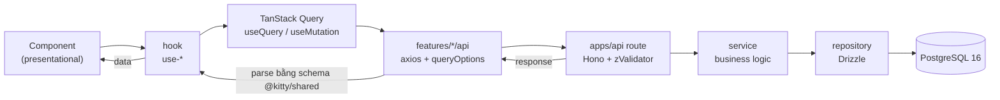

# 25 — Code Architecture

> **Trạng thái:** `@kitty/shared`, `@kitty/db` **đã tồn tại**; web đã có data layer (axios + TanStack Query + proxy `/api`), **auth UI + app shell** (`/sign-in`, `/sign-up`, `(app)` layout, sidebar, theme, demo login — KIT-24), shadcn/ui cài trực tiếp trong `apps/web` (`src/components/ui`, preset `b4VmS9QxUG`, [ADR-024](20-risks-and-decisions.md)), `apps/api` đã có Better Auth (bảng `app.user`/`session`/`account`/`verification` + `is_demo`) + `POST /api/demo-sign-in` + seed demo users; logger pino + `onError` dùng chung; gateway đã có `bun run sandbox:check`. File này chốt cấu trúc thư mục và luật phụ thuộc để mọi người code theo. Rules bắt buộc ở [CODE_RULES.md](../CODE_RULES.md).

Mục tiêu: tách rõ **hiển thị / logic / dữ liệu**, giữ **contract là một nguồn duy nhất** (`@kitty/shared`), và để mọi service backend (web BFF, `apps/api`, sau này gateway/agents/worker) dùng cùng một cách phân tầng.

## 1. Luồng request



- Request **vào** `apps/api`: `zValidator("json", schemaFromShared)` parse payload trước khi vào service.
- Response **ra**: tầng axios parse lại response bằng **cùng schema `@kitty/shared`** → type ở web luôn khớp server.
- Component không biết axios/query; hook không biết JSX.
- **Proxy same-origin:** browser chỉ gọi `/api/*` trên origin của web; `next.config.ts` `rewrites()` chuyển tiếp sang `apps/api` (`API_URL`). Nhờ vậy cookie auth là first-party (không cần CORS, không cần `SameSite=None`).

## 2. Tổng quan monorepo & luật phụ thuộc

```
kitty/
├─ apps/
│  ├─ web/                     # Next.js 16 (EXISTS)
│  ├─ api/                     # Hono on Bun (EXISTS)
│  └─ gateway/                 # Hono on Bun — Leash Gateway (EXISTS, skeleton)
├─ packages/
│  ├─ shared/                  # @kitty/shared — contracts (EXISTS)
│  ├─ db/                      # @kitty/db — Drizzle schema + client + migrations (EXISTS)
│  ├─ typescript-config/       # @kitty/typescript-config (EXISTS)
│  ├─ eslint-config/           # @kitty/eslint-config (EXISTS)
│  └─ prettier-config/         # @kitty/prettier-config (EXISTS)
└─ docs/
```

| Package | Vai trò | Trạng thái |
|---|---|---|
| `@kitty/shared` | Zod schema, type, enum, error code, API path, pure util — **contract** | exists |
| `@kitty/db` | Drizzle schema + client + migrations. **Chỉ `apps/api` và `apps/gateway` dùng.** | exists |
| `@kitty/typescript-config` / `eslint-config` / `prettier-config` | config dùng chung | exists |

**Luật phụ thuộc (MUST):**

- `web → shared`
- `api → shared, db`
- `db → shared` (được dùng `drizzle-zod` nội bộ)
- `shared → nothing` (không phụ thuộc package nội bộ nào)

**UI không còn là package:** component shadcn/ui sống ngay trong `apps/web/src/components/ui`, do CLI generate (preset `b4VmS9QxUG`) — xem [ADR-024](20-risks-and-decisions.md). Không tạo lại `packages/ui`.

**Cấm (MUST):** `web → db`; `shared →` bất cứ thứ gì app-specific (React, Hono, Drizzle, Node/Bun/browser API).

**Vì sao `db` tách khỏi `api`:** schema + migration có vòng đời riêng (drizzle-kit), và buộc `apps/web` không bao giờ chạm DB trực tiếp — web chỉ nói chuyện với `apps/api`.

## 3. apps/web — feature-based

Routes chỉ là vỏ mỏng; mọi thứ theo feature.

```
apps/web/
├─ src/
│  ├─ proxy.ts                     # ✅ Next 16 proxy: cookie-only redirect cho /events, /settings; /sign-in, /sign-up xác thực session thật (ADR-025)
│  ├─ app/                         # routes only (page/layout mỏng)
│  │  ├─ globals.css               # ✅ Tailwind v4 entry + theme mặc định của preset b4VmS9QxUG (CLI generate; không sửa tay)
│  │  ├─ layout.tsx                # ✅ bọc <Providers>, Inter + JetBrains Mono + Merriweather heading (CLI), suppressHydrationWarning
│  │  ├─ providers.tsx             # ✅ ThemeProvider + QueryClientProvider + TooltipProvider (+ devtools chỉ ở dev)
│  │  ├─ page.tsx                  # ✅ landing S01 (redirect user đã đăng nhập → /events), instant = false
│  │  ├─ sign-in/page.tsx          # ✅ S02 + "Try the demo (for judges)"
│  │  ├─ sign-up/page.tsx          # ✅ tạo tài khoản
│  │  └─ (app)/                    # ✅ vùng đã đăng nhập (layout check session thật, instant = false)
│  │     ├─ layout.tsx             # getServerSession() → redirect /sign-in
│  │     └─ events/                # S03: page + loading.tsx (Skeleton) + error.tsx (Alert)
│  │        └─ new/page.tsx        # S04 placeholder (KIT-21)
│  ├─ features/
│  │  ├─ system/                   # ✅ ví dụ mẫu để copy cho feature sau
│  │  │  ├─ api/system.api.ts      # axios fn + systemKeys + queryOptions
│  │  │  ├─ hooks/use-api-status.ts
│  │  │  └─ components/api-status-badge.tsx
│  │  ├─ auth/                     # ✅ KIT-24
│  │  │  ├─ components/            # auth-shell, sign-in-form, sign-up-form, demo-sign-in-button
│  │  │  ├─ api/demo-login.api.ts  # ✅ status query (axios + queryOptions)
│  │  │  ├─ hooks/                 # use-sign-in-form, use-sign-up-form, use-demo-sign-in, use-demo-login-status
│  │  │  └─ lib/auth-error.ts      # map lỗi Better Auth/API → câu hiển thị
│  │  ├─ shell/                    # ✅ KIT-24: app-shell, app-sidebar, app-top-bar, theme-toggle, user-menu
│  │  │  ├─ components/…
│  │  │  ├─ hooks/                 # use-app-nav (nav từ sitemap docs/23), use-theme-toggle, use-user-menu
│  │  │  └─ lib/initials.ts
│  │  └─ events/                   # ✅ empty/skeleton/error state (list thật ở KIT-21)
│  │     ├─ components/events-empty-state.tsx · events-skeleton.tsx · events-error.tsx
│  │     └─ hooks/use-events-error.ts
│  ├─ components/                  # component ghép chung toàn app
│  │  ├─ brand/logo.tsx            # ✅ <Logo /> — mark + wordmark, currentColor (brand đi qua đây)
│  │  └─ ui/                       # ✅ shadcn/ui do CLI generate (preset b4VmS9QxUG) — VENDOR, không sửa tay
│  ├─ hooks/                       # hook chung toàn app
│  │  ├─ use-mobile.ts             # ✅ CLI generate (sidebar dùng)
│  │  └─ use-highlighted-code.ts   # ✅ CLI generate (code-block dùng)
│  ├─ lib/
│  │  ├─ http.ts                   # ✅ axios instance (baseURL "/api", withCredentials) + ApiRequestError
│  │  ├─ query-client.ts           # ✅ makeQueryClient/getQueryClient (staleTime 30s, không retry 4xx)
│  │  ├─ auth-client.ts            # ✅ better-auth/react
│  │  ├─ server-session.ts         # ✅ getServerSession() — gọi /api/auth/get-session qua rewrite
│  │  ├─ auth-redirect.ts          # ✅ resolveAuthRedirect() (pure, proxy dùng; test ở test/lib)
│  │  ├─ utils.ts                  # ✅ CLI generate — cn() re-export
│  │  ├─ highlighter.tsx           # ✅ CLI generate (code-block dùng)
│  │  ├─ routes.ts                 # ✅ routes + buildSignInPath/readNextPath
│  │  └─ env.ts                    # ✅ zod-validated env (clientEnv + getServerEnv)
│  └─ providers/
│     └─ theme-provider.tsx        # ✅ next-themes (attribute="class")
├─ test/                           # ✅ test mirror src/ (auth-error, initials, auth-redirect), alias @/
├─ components.json                 # ✅ CLI generate (preset b4VmS9QxUG) — không sửa tay
├─ eslint.config.js
└─ tsconfig.json
```

**Vì sao:**

- `src/app/` mỏng → route dễ đọc; logic ở `features/`.
- Mỗi feature tự chứa `api` + `hooks` + `components` + `utils` → xoá/sửa feature không lan.
- `lib/http.ts` là điểm duy nhất tạo axios instance → mọi interceptor/cookie ở một chỗ.
- `features/system/` là **ví dụ mẫu hoàn chỉnh** (api → hook → component) để feature sau copy; component không chứa logic.
- `lib/http.ts` (`baseURL: "/api"`) + `next.config.ts` `rewrites()` → browser same-origin, cookie auth first-party.
- Auth: UI ở `features/auth`, quyết định redirect ở 2 hook pure (`lib/auth-redirect.ts` — proxy dùng, `lib/routes.ts` — `?next=`), session thật đọc ở server (`lib/server-session.ts`) → component không tự gọi auth API. Lý do + đánh đổi ở [ADR-022](20-risks-and-decisions.md).
- Layout class **không** đặt trên component shadcn (rule `@shadcn/lint/no-restyle`): bọc trong `div`/`span` thường, đúng như `features/system` đã làm.

## 4. apps/api — modular theo domain

```
apps/api/
├─ src/
│  ├─ index.ts                     # ✅ Bun entry: { port, fetch: app.fetch }
│  ├─ app.ts                       # ✅ Hono app: onError + mount /api (và /api/auth/*)
│  ├─ env.ts                       # ✅ zod-validated env
│  ├─ lib/
│  │  ├─ auth.ts                   # ✅ Better Auth instance (Drizzle adapter, lazy getAuth)
│  │  ├─ db.ts                     # ✅ drizzle client (từ @kitty/db)
│  │  ├─ admin-signing.ts          # ✅ ký request Gateway Admin API (docs/10 §1)
│  │  ├─ gateway-client.ts         # ✅ axios client tới Gateway Admin API (lazy)
│  │  ├─ params.ts                 # ✅ schema path-param (evt_/mem_/ven_)
│  │  ├─ narrow.ts                 # ✅ narrow text column → union sau runtime check
│  │  ├─ tokens.ts                 # ✅ member_token 32 byte base64url
│  │  ├─ validate.ts               # ✅ hook zValidator → shape lỗi dùng chung
│  │  ├─ r2.ts                     # (kế hoạch) S3 client + presign helper
│  │  ├─ logger.ts                 # ✅ pino (redact secret/PII)
│  │  └─ errors.ts                 # ✅ AppError + shape lỗi dùng chung
│  ├─ middleware/
│  │  ├─ session.ts                # ✅ c.var.user/session + requireSession + AppEnv
│  │  ├─ require-role.ts           # (kế hoạch)
│  │  └─ request-id.ts             # (kế hoạch)
│  └─ modules/
│     ├─ system/
│     │  └─ system.routes.ts       # ✅ GET /api/health (mount dưới /api)
│     ├─ auth/
│     │  ├─ demo.routes.ts         # ✅ POST /api/demo-sign-in (+ GET .../status; 404 khi tắt, 429 rate limit)
│     │  └─ demo.service.ts        # ✅ isDemoLoginEnabled() + signInEmail({ asResponse: true }) với DEMO_USER_PASSWORD
│     ├─ events/                   # ✅ KIT-30
│     │  ├─ events.routes.ts       # Hono router + zValidator → service
│     │  ├─ events.service.ts      # business logic (không type Hono)
│     │  ├─ events.repository.ts   # chỉ Drizzle
│     │  └─ events.ownership.ts    # guard organizer (404/403) dùng lại
│     ├─ members/                  # ✅ KIT-30 (routes/service/repository)
│     ├─ vendors/                  # ✅ KIT-30 (+ verify → gateway payee)
│     └─ budget-lines/             # ✅ KIT-30 (PUT replace set)
├─ test/                           # ✅ mirror src/ — test KHÔNG nằm cạnh code ([CODE_RULES.md](../CODE_RULES.md) §F)
│  ├─ app.test.ts                  # tests src/app.ts
│  ├─ lib/                         # admin-signing.test.ts · client-ip.test.ts · fixed-window-rate-limit.test.ts
│  ├─ modules/                     # mirror src/modules: events/… · members/… · vendors/… · budget-lines/… · auth/…
│  └─ support/                     # ✅ fixture/helper dùng chung: fakes.ts · session.ts (không phải *.test.ts)
├─ scripts/
│  ├─ seed-demo-users.ts           # ✅ root script `seed:demo-users` (idempotent, signUpEmail)
│  └─ smoke-events.ts              # ✅ KIT-30 `bun run --filter api smoke:events` (không trong CI)
└─ tsconfig.json
```

**Vì sao:**

- Một module = một domain; `routes → service → repository` bắt buộc (xem [CODE_RULES.md](../CODE_RULES.md) §D).
- `app.ts` tách khỏi `index.ts` để test được Hono app (`app.request`) mà không mở port.
- `GET /health` ở root giữ cho health check hạ tầng; route sản phẩm nằm dưới `/api` (`GET /api/health` để verify proxy).
- `/api/auth/*` mount trong `app.ts`; các route sản phẩm (`/api/events/...`) được gắn `sessionMiddleware` + `requireSession` trên một router con — signed-out → `401 UNAUTHORIZED` trước handler. Authorization (session user là organizer của event) kiểm trong service.

## 5. packages/shared — contract

```
packages/shared/
├─ src/
│  ├─ index.ts
│  ├─ api-paths.ts                 # apiPaths const
│  ├─ common/
│  │  ├─ api-error.schema.ts       # shape { error: { code, message, details? } } + errorCodes
│  │  ├─ ids.ts                    # idPrefixes + idSchema(prefix)
│  │  ├─ money.schema.ts           # cents (integer) + formatCents()
│  │  ├─ pagination.schema.ts      # cursor pagination helper
│  │  └─ index.ts
│  ├─ auth/                        # ✅ KIT-24
│  │  ├─ auth.schema.ts            # signInSchema, signUpSchema, authSessionSchema, safeNextPath()
│  │  ├─ auth.types.ts             # SignInInput, SignUpInput, AuthSessionPayload…
│  │  └─ index.ts
│  └─ health/
│     ├─ health-response.schema.ts # { ok: true }
│     └─ index.ts
├─ test/                           # ✅ mirror src/ — test KHÔNG nằm cạnh code ([CODE_RULES.md](../CODE_RULES.md) §F)
│  ├─ domain-contracts.test.ts
│  ├─ common/                      # ids.test.ts · money.test.ts
│  ├─ auth/auth.schema.test.ts
│  └─ leash-agent/leash-agent.test.ts
└─ package.json                    # exports: "." + "./common" + "./auth" + "./health" + "./api-paths"
```

**Vì sao:** cả `apps/web` và `apps/api` import cùng schema → validate ở server và type ở client không bao giờ lệch. Đổi contract = đổi ở đây trước.

## 6. packages/db (và UI trong `apps/web`)

```
packages/db/
├─ src/
│  ├─ client.ts                    # createDb(DATABASE_URL) — Neon pooled, prepare: false
│  ├─ schema/
│  │  ├─ app-schema.ts             # pgSchema("app") — tách riêng để tránh import cycle app↔auth
│  │  ├─ app.ts                    # app.events/members/budget_lines/vendors (+ user FK)
│  │  ├─ auth.ts                   # app.user/session/account/verification (Better Auth)
│  │  ├─ leash.ts                  # pgSchema("leash")
│  │  └─ index.ts
│  └─ index.ts
├─ test/                           # ✅ mirror src/ — test KHÔNG nằm cạnh code ([CODE_RULES.md](../CODE_RULES.md) §F)
│  └─ schema/leash.test.ts         # tests src/schema/leash.ts
├─ migrations/                     # drizzle-kit generate → SQL
├─ drizzle.config.ts               # đọc DATABASE_URL_UNPOOLED (direct) cho migrations
├─ .env.example                    # DATABASE_URL_UNPOOLED (chỉ migrations)
└─ package.json
```

**UI (shadcn/ui) không còn là package** ([ADR-024](20-risks-and-decisions.md)): CLI generate thẳng vào `apps/web/src/components/ui` (+ `src/hooks`, `src/lib/utils.ts` = `cn`, `src/app/globals.css` = theme mặc định của preset `b4VmS9QxUG`). File CLI sinh ra là **vendor — không sửa tay**; khi cần thì tắt đúng rule cho đúng path trong `apps/web/eslint.config.js`.

**Vì sao:** `db` gom schema/migration một chỗ; UI nằm ngay trong app đang dùng nó để `bunx shadcn add/apply` chạy trực tiếp, không phải map alias/token qua một package trung gian.

## 7. Ánh xạ với kiến trúc [docs/06](06-architecture.md)

`apps/api` là **backend service đầu tiên** áp phân tầng `routes → services → repositories` + `@kitty/shared`.

Các service kế hoạch trong [docs/06](06-architecture.md) (`apps/gateway`, `apps/agents`, `apps/worker`) **dùng lại đúng phân tầng này và `@kitty/shared`**:

- `gateway` vẫn giữ policy thuần (`packages/leash`) và là nơi duy nhất có PayPal secret — các bất biến tiền ở [docs/05](05-leash-spec.md) và AGENTS.md §3 **không đổi**.
- `agents` vẫn là service duy nhất giải mã LLM key (BYOK, [docs/24](24-byok-ai-models.md)) — các rule trong CODE_RULES.md không thay đổi điều đó.
- `worker` xử lý outbox/cron, cũng theo `routes/services/repositories` (routes ở đây là HTTP nội bộ + job handler).

> Ghi chú: [docs/07](07-tech-stack.md) trước đây dùng Hono RPC (`hc<AppType>`) để chia type. Đề xuất này **thay bằng contract `@kitty/shared`** (xem ADR-016 ở [docs/20](20-risks-and-decisions.md)) — type đến từ Zod schema, không phụ thuộc vào shape router của Hono.

## 8. Thêm một feature mới (walkthrough)

1. **Contract** — viết schema Zod ở `packages/shared/src/<domain>/<domain>.schema.ts` (+ type `z.infer`), export qua `src/index.ts` và subpath.
2. **DB** — thêm bảng ở `packages/db/src/schema/<domain>.ts`, `bunx drizzle-kit generate`, review migration.
3. **Repository** — `apps/api/src/modules/<domain>/<domain>.repository.ts` (Drizzle).
4. **Service** — `.../<domain>.service.ts` (business logic, type tường minh, không type Hono).
5. **Route** — `.../<domain>.routes.ts` (`zValidator` với schema shared → gọi service), mount trong `app.ts`.
6. **Web api** — `apps/web/src/features/<domain>/api/<domain>.api.ts` (axios fn + `keys` + `queryOptions`).
7. **Hook** — `apps/web/src/features/<domain>/hooks/use-<domain>.ts` (`useQuery`/`useMutation` + invalidation).
8. **Component** — `apps/web/src/features/<domain>/components/*.tsx` (chỉ JSX + gọi hook).

Kiểm tra trước khi mở PR: `bun run ci` pass + checklist trong [CODE_RULES.md](../CODE_RULES.md) §F.
