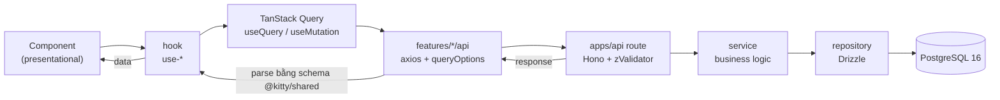

# 25 — Code Architecture

> **Trạng thái:** `@kitty/shared`, `@kitty/db`, `@kitty/ui` **đã tồn tại**. File này chốt cấu trúc thư mục và luật phụ thuộc để mọi người code theo. Rules bắt buộc ở [CODE_RULES.md](../CODE_RULES.md).

Mục tiêu: tách rõ **hiển thị / logic / dữ liệu**, giữ **contract là một nguồn duy nhất** (`@kitty/shared`), và để mọi service backend (web BFF, `apps/api`, sau này gateway/agents/worker) dùng cùng một cách phân tầng.

## 1. Luồng request



- Request **vào** `apps/api`: `zValidator("json", schemaFromShared)` parse payload trước khi vào service.
- Response **ra**: tầng axios parse lại response bằng **cùng schema `@kitty/shared`** → type ở web luôn khớp server.
- Component không biết axios/query; hook không biết JSX.

## 2. Tổng quan monorepo & luật phụ thuộc

```
kitty/
├─ apps/
│  ├─ web/                     # Next.js 16 (EXISTS)
│  ├─ api/                     # Hono on Bun (EXISTS)
│  └─ gateway/                 # Hono on Bun — Leash Gateway (EXISTS, skeleton)
├─ packages/
│  ├─ shared/                  # @kitty/shared — contracts (EXISTS)
│  ├─ db/                      # @kitty/db — Drizzle schema + client + migrations (EXISTS)
│  ├─ ui/                      # @kitty/ui — shadcn/ui + tokens + cn() (EXISTS)
│  ├─ typescript-config/       # @kitty/typescript-config (EXISTS)
│  ├─ eslint-config/           # @kitty/eslint-config (EXISTS)
│  └─ prettier-config/         # @kitty/prettier-config (EXISTS)
└─ docs/
```

| Package | Vai trò | Trạng thái |
|---|---|---|
| `@kitty/shared` | Zod schema, type, enum, error code, API path, pure util — **contract** | exists |
| `@kitty/db` | Drizzle schema + client + migrations. **Chỉ `apps/api` và `apps/gateway` dùng.** | exists |
| `@kitty/ui` | shadcn/ui components (setup monorepo), Tailwind tokens, `cn()` | exists |
| `@kitty/typescript-config` / `eslint-config` / `prettier-config` | config dùng chung | exists |

**Luật phụ thuộc (MUST):**

- `web → shared, ui`
- `api → shared, db`
- `db → shared` (được dùng `drizzle-zod` nội bộ)
- `shared → nothing` (không phụ thuộc package nội bộ nào)

**Cấm (MUST):** `web → db`; `shared →` bất cứ thứ gì app-specific (React, Hono, Drizzle, Node/Bun/browser API).

**Vì sao `db` tách khỏi `api`:** schema + migration có vòng đời riêng (drizzle-kit), và buộc `apps/web` không bao giờ chạm DB trực tiếp — web chỉ nói chuyện với `apps/api`.

## 3. apps/web — feature-based

Routes chỉ là vỏ mỏng; mọi thứ theo feature.

```
apps/web/
├─ src/
│  ├─ app/                         # routes only (page/layout mỏng)
│  │  ├─ layout.tsx
│  │  ├─ page.tsx
│  │  └─ events/
│  │     ├─ page.tsx
│  │     └─ [id]/page.tsx
│  ├─ features/
│  │  └─ events/
│  │     ├─ api/
│  │     │  └─ events.api.ts       # axios fn + eventsKeys + queryOptions
│  │     ├─ components/
│  │     │  ├─ event-list.tsx
│  │     │  └─ event-form.tsx
│  │     ├─ hooks/
│  │     │  ├─ use-events.ts
│  │     │  └─ use-event-form.ts
│  │     └─ utils/
│  │        └─ format-date.ts
│  ├─ components/                  # component ghép chung toàn app
│  ├─ hooks/                       # hook chung toàn app
│  ├─ lib/
│  │  ├─ http.ts                   # axios instance (baseURL từ env, withCredentials)
│  │  ├─ query-client.ts
│  │  ├─ auth-client.ts            # better-auth/react
│  │  └─ env.ts                    # zod-validated env
│  └─ providers/
│     ├─ query-provider.tsx        # QueryClientProvider
│     └─ theme-provider.tsx
├─ eslint.config.js
└─ tsconfig.json
```

**Vì sao:**

- `src/app/` mỏng → route dễ đọc; logic ở `features/`.
- Mỗi feature tự chứa `api` + `hooks` + `components` + `utils` → xoá/sửa feature không lan.
- `lib/http.ts` là điểm duy nhất tạo axios instance → mọi interceptor/cookie ở một chỗ.

## 4. apps/api — modular theo domain

```
apps/api/
├─ src/
│  ├─ index.ts                     # Bun entry: { port, fetch: app.fetch }
│  ├─ app.ts                       # Hono app: middleware, onError, mount routes
│  ├─ env.ts                       # zod-validated env
│  ├─ lib/
│  │  ├─ auth.ts                   # Better Auth instance (Drizzle adapter)
│  │  ├─ db.ts                     # drizzle client (từ @kitty/db)
│  │  ├─ r2.ts                     # S3 client + presign helper
│  │  ├─ logger.ts                 # pino (redact secret/PII)
│  │  └─ errors.ts                 # AppError + shape lỗi dùng chung
│  ├─ middleware/
│  │  ├─ auth.ts                   # gán c.var.user / c.var.session
│  │  ├─ require-role.ts
│  │  └─ request-id.ts
│  └─ modules/
│     └─ events/
│        ├─ events.routes.ts       # Hono router + zValidator → service
│        ├─ events.service.ts      # business logic (không type Hono)
│        └─ events.repository.ts   # chỉ Drizzle
└─ tsconfig.json
```

**Vì sao:**

- Một module = một domain; `routes → service → repository` bắt buộc (xem [CODE_RULES.md](../CODE_RULES.md) §D).
- `app.ts` tách khỏi `index.ts` để test được Hono app (`app.request`) mà không mở port.

## 5. packages/shared — contract

```
packages/shared/
├─ src/
│  ├─ index.ts
│  ├─ api-paths.ts                 # apiPaths const
│  ├─ common/
│  │  ├─ api-error.schema.ts       # shape { error: { code, message, details? } } + errorCodes
│  │  ├─ ids.ts                    # idPrefixes + idSchema(prefix)
│  │  ├─ money.schema.ts           # cents (integer) + formatCents()
│  │  ├─ pagination.schema.ts      # cursor pagination helper
│  │  └─ index.ts
│  └─ health/
│     ├─ health-response.schema.ts # { ok: true }
│     └─ index.ts
└─ package.json                    # exports: "." + "./common" + "./health" + "./api-paths"
```

**Vì sao:** cả `apps/web` và `apps/api` import cùng schema → validate ở server và type ở client không bao giờ lệch. Đổi contract = đổi ở đây trước.

## 6. packages/db và packages/ui

```
packages/db/
├─ src/
│  ├─ client.ts                    # createDb(DATABASE_URL) — Neon pooled, prepare: false
│  ├─ schema/
│  │  ├─ app.ts                    # pgSchema("app")
│  │  ├─ leash.ts                  # pgSchema("leash")
│  │  └─ index.ts
│  └─ index.ts
├─ migrations/                     # drizzle-kit generate → SQL
├─ drizzle.config.ts               # đọc DATABASE_URL_UNPOOLED (direct) cho migrations
├─ .env.example                    # DATABASE_URL_UNPOOLED (chỉ migrations)
└─ package.json

packages/ui/
├─ src/
│  ├─ components/                  # shadcn/ui components (CLI generate): button, card, input, label, badge
│  ├─ lib/
│  │  └─ utils.ts                  # cn() = clsx + tailwind-merge
│  └─ styles/globals.css           # Tailwind v4 + shadcn theme tokens (light + dark)
├─ components.json                 # config cho shadcn CLI (monorepo)
└─ package.json                    # exports: ./styles/globals.css, ./components/*, ./lib/*
```

**Vì sao:** `db` gom schema/migration một chỗ; `ui` là nơi duy nhất chứa component shadcn/ui + `cn()` để web và (sau này) các app UI khác dùng lại cùng token.

## 7. Ánh xạ với kiến trúc [docs/06](06-architecture.md)

`apps/api` là **backend service đầu tiên** áp phân tầng `routes → services → repositories` + `@kitty/shared`.

Các service kế hoạch trong [docs/06](06-architecture.md) (`apps/gateway`, `apps/agents`, `apps/worker`) **dùng lại đúng phân tầng này và `@kitty/shared`**:

- `gateway` vẫn giữ policy thuần (`packages/leash`) và là nơi duy nhất có PayPal secret — các bất biến tiền ở [docs/05](05-leash-spec.md) và AGENTS.md §3 **không đổi**.
- `agents` vẫn là service duy nhất giải mã LLM key (BYOK, [docs/24](24-byok-ai-models.md)) — các rule trong CODE_RULES.md không thay đổi điều đó.
- `worker` xử lý outbox/cron, cũng theo `routes/services/repositories` (routes ở đây là HTTP nội bộ + job handler).

> Ghi chú: [docs/07](07-tech-stack.md) trước đây dùng Hono RPC (`hc<AppType>`) để chia type. Đề xuất này **thay bằng contract `@kitty/shared`** (xem ADR-016 ở [docs/20](20-risks-and-decisions.md)) — type đến từ Zod schema, không phụ thuộc vào shape router của Hono.

## 8. Thêm một feature mới (walkthrough)

1. **Contract** — viết schema Zod ở `packages/shared/src/<domain>/<domain>.schema.ts` (+ type `z.infer`), export qua `src/index.ts` và subpath.
2. **DB** — thêm bảng ở `packages/db/src/schema/<domain>.ts`, `bunx drizzle-kit generate`, review migration.
3. **Repository** — `apps/api/src/modules/<domain>/<domain>.repository.ts` (Drizzle).
4. **Service** — `.../<domain>.service.ts` (business logic, type tường minh, không type Hono).
5. **Route** — `.../<domain>.routes.ts` (`zValidator` với schema shared → gọi service), mount trong `app.ts`.
6. **Web api** — `apps/web/src/features/<domain>/api/<domain>.api.ts` (axios fn + `keys` + `queryOptions`).
7. **Hook** — `apps/web/src/features/<domain>/hooks/use-<domain>.ts` (`useQuery`/`useMutation` + invalidation).
8. **Component** — `apps/web/src/features/<domain>/components/*.tsx` (chỉ JSX + gọi hook).

Kiểm tra trước khi mở PR: `bun run ci` pass + checklist trong [CODE_RULES.md](../CODE_RULES.md) §F.
